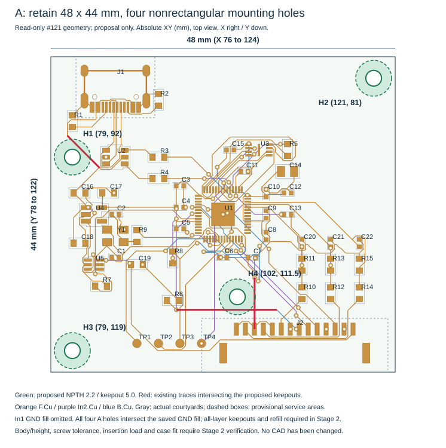
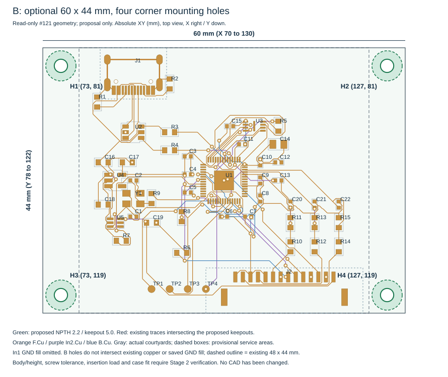

# Issue #153 — Main 取付穴追加の実現性と配置案（Stage 1）

**48×44mmを維持し、φ2.2mm NPTHを4個追加する非矩形配置を第一案とする。部品・パッド・既存ビアの移動を要しない公称配置を得た。φ5mmの予約領域に干渉する既存配線は、VBUS／GND／WING_ENの計3セグメントである。** 配線完成・ねじ締結強度の確認はStage 2に残る。四隅の矩形配置を要求する場合には、左右各6mmを追加する60×44mm案も成立候補となる。

[Issue #153](https://github.com/ihsinoky/he-piantor-42/issues/153) と指定指示書を全文読んで実施した。以下Eは[今回追加した証跡](../hardware/kicad/qualification/issue-153-main-mounting-stage1/)を指す。**基板・回路・既存文書は変更していない。再配線、再充填、製造データ生成、発注、課金、mergeは実施していない。** 本文の穴と外形は採用前の提案であり、Stage 2はPOの確認後に実施する。

## 1. 入力と測定の範囲

作業起点はmain `f2a6c1388969f42b5a68f8a062fcbcf515b577f2`。`git ls-remote origin refs/heads/main`と一致した。作業ブランチは`issue-153-main-mounting-stage1`。通常の`.git`は書込み制限があるため、同じ作業ツリーを使う`.issue153-runtime/git`にメタデータをコピーしてブランチを作成した。既存の未追跡#147／#149／#150成果物も保全対象に含めた。

| 入力 | 用途・扱い |
| --- | --- |
| [#121合格出力](../hardware/kicad/qualification/issue-121-full-auto-conditions/evidence/inspection/main-cell1/krt/main.kicad_pcb) | 再充填済みMainを直接読取り。入力や旧JITX板を合格出力の代用にしない。SHA256 `6163ae55…45ed2dd`（全桁はE/inputs.json） |
| [#121報告](issue-121-full-auto-conditions.md)、入力側project、independent.json | 4層、幅／間隙0.10、via0.60/0.30、独立4指標0の基準と再資格確認手順 |
| [#137報告](issue-137-main-manufacturing-review-prep.md)、board-analysis.json | 66ビア・25箇所のPOFV観察、J1のPTH／NPTH形状との照合 |
| [D-017／D-019／D-022](decisions.md)、[Main/Wing契約](../hardware/rev-m1/main-wing-interface.md)、[G0B](../hardware/rev-m1/g0b-freeze-proposal.md) | 電気インタフェース、Main製造・配線条件、POFVとJ1工程を保持 |
| [#150](https://github.com/ihsinoky/he-piantor-42/issues/150) Stage 1報告の保存抜粋（[E/inputs.json](../hardware/kicad/qualification/issue-153-main-mounting-stage1/inputs.json)） | Main穴なし・絶縁トレイ／着脱クリップ案を確認。開始時に未追跡のため、hashと該当段落を保存し、#150成果物は本PRに含めない。Main寸法・穴は#121から独立に再確認 |
| [Wing16 definition](../hardware/jitx/wing/generated/representative21-16mm/definition.json)、#141 Wing16合格PCB | 四隅NPTH φ2.2、φ5.0予約領域、板端から中心3mmの前例。Wingの電気ルールをMainへ移植しない |

実データは**X76–124／Y78–122、48×44、厚さ1.2mm、49フットプリント、199パッド、540トラック、66ビア、In1.CuのGND zone 1個**。トラックはF.Cu 471／In1.Cu 0／In2.Cu 33／B.Cu 36、幅0.10が537本、0.20が3本。筐体用穴は0個。J1のφ0.65 NPTH×2とPTH固定脚×4はUSB部品用で、筐体締結穴ではない。

座標は**表から見たKiCad絶対XY、mm、X右・Y下**。ローカル座標は各案の左上外形を原点とし、A／A0では(76,78)、Bでは(70,78)とする。E/measurements.jsonとE/candidates.csvも同じ基準である。円の距離は中心間ではなく、**既存銅箔外周からφ5予約円外周までの最短隙間**を示す。正は離隔、負は食込み。ビアは穴径0.30だけでなく銅箔外径0.60で評価した。

S式を読む標準Python計算と、KiCad 9.0.9の`GetEffectiveShape`／`Distance`／`Collide`を照合した。19候補全件のパッド・トラック・ビア干渉集合と最短距離、既存72ドリル、188本のboard-level F.CrtYd線（40個の閉多角形）を確認し、距離差は2nm以内。保存済みGND充填との衝突は別集計した。結果は[E/measurements.json](../hardware/kicad/qualification/issue-153-main-mounting-stage1/measurements.json)と[E/native-crosscheck.json](../hardware/kicad/qualification/issue-153-main-mounting-stage1/native-crosscheck.json)。

**部品体積の限界**：フットプリント内にbody／courtyard図形はなく、courtyardは基板図形として存在した。40搭載部品はその実多角形を検査できた。J1・J2・U1・U3・Y1には閉courtyardがなく、TP4個にもない。補助スクリーニングとして全パッド包絡を各辺0.5mm拡大し、さらにJ1にX79.5–90.5／Y76–86.5、J2にX97–123／Y114.5–122のサービス予約矩形を仮置きした。これは部品メーカーの保証外形・3D干渉検査ではない。ねじ頭、工具、ボス、下面はんだ、ケーブルの実体積をStage 2で確認する。

## 2. 第一案A：48×44mm、4穴、部品・ビア固定

共通仕様は**NPTH φ2.2、めっき・電気ネットなし、表裏の頭／座／ボスと全銅層にφ5.0の円形予約領域**。M2通しねじ＋絶縁スペーサを候補とする。ねじ頭・座金・接触ボスの最大投影外径はφ4.5以下を設計条件とし、皿もみをしない。Wing前例と径を揃えるが、Mainの4点は矩形ではなく、同じボス配置の流用はできない。

| 穴 | 絶対XY | ローカルXY | 最近板端まで中心 | 穴縁→板端 | φ5縁→板端 | φ4.5頭縁→板端 |
| --- | --- | --- | ---: | ---: | ---: | ---: |
| H1（W-upper） | 79,92 | 3,14 | 3.00 | 1.90 | 0.50 | 0.75 |
| H2（NE-corner） | 121,81 | 45,3 | 3.00 | 1.90 | 0.50 | 0.75 |
| H3（SW-corner） | 79,119 | 3,41 | 3.00 | 1.90 | 0.50 | 0.75 |
| H4（S-proposed） | 102,111.5 | 26,33.5 | 10.50 | 9.40 | 8.00 | 8.25 |

| 穴 | φ5→最近パッド | φ5→最近トラック | φ5→最近ビア銅箔 | φ5→実courtyard | φ5→補助部品／サービス予約 | 新穴縁→既存ドリル縁 |
| --- | ---: | ---: | ---: | ---: | ---: | ---: |
| H1 | +1.275（R1） | **−0.924（VBUS）** | +1.900 | +0.995（R1） | +0.775（R1包絡） | +3.450 |
| H2 | +11.985（R5） | +11.649 | +13.126 | +11.603（R5） | +11.285 | +14.676 |
| H3 | +5.955（TP1） | +5.421 | +8.368 | +6.120（R7） | +5.400（TP1包絡） | +9.918 |
| H4 | +1.150（J2.14） | **−0.750（WING_EN）** | +0.812 | +2.618（C6） | +0.500（J2予約） | +2.362 |

H1–H3は27mm、H3–H4は24.192mm、全体の中心スパンはX42／Y38mm。6組すべての中心距離はE/plans.jsonにある。穴同士のφ5円は重ならない。H4をGH直下の右下隅に置かず、GHパッド列の手前へ逃がす配置である。J1／J2の挿抜荷重をこの非矩形4支点で受けられるか、GH右端側の張出しと基板たわみを検査する。必要な補助絶縁支点の位置を、銅箔・ビア・はんだを避けて別途決める。

φ4.5とφ5の差で得る半径余裕は**0.25mm**。ねじの偏心、穴位置、ケースボス位置、座金径の合成誤差をこの範囲へ納めるか、予約径を広げて再計算する必要がある。完成穴径・外形・位置の製造公差は未確認。ケース側の浮動ナット／逃げで位置誤差を吸収し、1.2mm板を四点締結で反らせない。H4は仮サービス矩形までφ5で0.5mm、φ4.5頭で0.75mm。仮に工具包絡φ6ならその矩形へ接するため、GHハーネスを外してねじへアクセスする組立順序も検討する。工具径やねじ長・締付けトルクは未選定である。

### 現行配線との干渉は3セグメント

| 穴 | net／層／幅 | 現行中心線の端点XY | φ5への食込み | 新φ2.2穴縁→銅箔 |
| --- | --- | --- | ---: | ---: |
| H1 | VBUS／F.Cu／0.10 | (82.8,93.5)→(78.3,89.0) | 0.924 | +0.476 |
| H4 | WING_EN／B.Cu／0.10 | (93.5,113.3)→(107.5,113.3) | 0.750 | +0.650 |
| H4 | GND／F.Cu／0.10 | (104.4,108.8)→(104.4,116.0) | 0.150 | +1.250 |

UUIDを含む一覧は[E/affected-copper.csv](../hardware/kicad/qualification/issue-153-main-mounting-stage1/affected-copper.csv)。これは3ネット・3セグメントという**直接の幾何干渉の下限**で、再配線で変わる全セグメント数の予測ではない。いずれもφ2.2のドリル円だけにはかからないが、ねじ頭／座とφ5予約領域を守るため配線を退避する。φ5にかかる部品パッド0、既存ビア0。既存0.20mmの3トラックも直接干渉しない。

**4穴すべてで、ドリル円とφ5円が現行In1.Cu GND充填に重なる。** 信号線だけを避けても現基板へ追い穴はできない。Stage 2で全銅層のkeepoutを設け、GNDを抜いて再充填・再検証する。4個のφ5円の面積和は78.54mm²（基板面積の3.72%）だが、既存の他ネット抜き等との重複があるため、これは実際に失う銅箔面積でも、帰路品質の保証でもない。

## 3. 他の候補と採否

基板内の中心候補を0.5mm格子、板端から中心3mm以上で**6,545点**走査した。実courtyardと補助予約に入らない1,545点のうち、パッド・トラック・ビアまでφ5で離せるのは1,229点。GNDプレーンを除いた公称スクリーニングであり、連続空間の全解や3D実装可能性の証明ではない。[分布図](../hardware/kicad/qualification/issue-153-main-mounting-stage1/survey-map.svg)、[19候補の寸法CSV](../hardware/kicad/qualification/issue-153-main-mounting-stage1/candidates.csv)を保存した。

| 候補・案 | 寸法・干渉 | 評価 |
| --- | --- | --- |
| 通常の左上隅(79,81) | J1.13のPTHランドへφ5が1.160mm食込み、GND線2本にも干渉。USBサービス予約へ2.0mm食込み | J1を保持する条件では不採用。穴径だけで判断しない |
| 通常の右下隅(121,119) | J2.15固定ランドへφ5が1.975mm食込み、GHサービス内 | J2固定ランドは無ネットでも実装物なので不採用 |
| 右下寄り(121,112) | R14／R15のパッド計2個、配線1本に干渉 | 抵抗群を動かす案を第一案にしない |
| 左中央(79,100) | U4パッド等3個・配線15本・ビア1個に干渉 | 電源部への影響が広く不採用 |
| 南中央(94,119) | TP3パッド・配線6本に干渉 | SWD／RUN等のアクセス列を保持するため不採用 |
| 左側(79,93.5) | 配線干渉0だがφ5→VBUSは0.066、補助部品予約まで0.025 | 公称だけの狭い逃げ。H1の代わりに採用しない |
| 内側(105,111) | パッド0だが配線9本・ビア2個に干渉 | H4を(102,111.5)へずらすと2本・ビア0まで減らせる |
| 内側(104,112) | 配線2本、最近ビアのφ5余裕0.046、GH予約へ接する | H4案より公差余裕が少ない |
| 内側(101.5,110.5) | パッド・配線・ビア干渉0、最短配線余裕0.150（In2のQSPI_SS_FLASH） | 第4支点候補だが細い余裕。無理に配線無変更を優先しない |
| **A0：3穴、48×44** | (96,81)、(121,98)、(79,119)。φ5の最小余裕はパッド2.361／配線2.700／ビア6.194、補助予約1.722 | 信号・ビア移動を避けたい場合の比較案。3穴ともGND抜きは必要。USB／GHの支持・挿抜時の張出しを評価して採否を決める |

## 4. 外形拡張案B：60×44mm、四隅4穴

外形X70–130／Y78–122、中心(100,100)を保持し、**H1(73,81)、H2(127,81)、H3(73,119)、H4(127,119)**。φ2.2／φ5と頭・ボスφ4.5以下はAと同じ。新外形左上を原点とした穴位置は(3,3)、(57,3)、(3,41)、(57,41)、ピッチ54×38mm。

全中心が新板端から3mmで、穴縁1.9／φ5縁0.5／頭縁0.75mmを確保する。最小のφ5対既存パッド／配線／ビア隙間はそれぞれ**4.025／5.080／7.736mm**、補助サービス予約まで1.5mm。既存銅箔・既存GND充填への直接干渉は0で、部品・ビア・既存配線を動かさずに四隅配置を得る案である。拡張域へGNDを延ばす場合も穴周囲の全層keepoutを守る。

外形面積は2,112→2,640mm²、**25%増**。48×44という旧見積条件・トレイ内寸・底面ボス配置は使い直せない。#150の片側隙間0.5＋壁2.0という仮予算だけを適用すると、Mainポッド平面包絡は53×49→65×49mm（締結耳、プラグ、電線の余裕は別）。これは発注可能な確定筐体寸法ではない。

J1(85,81)・J2(110,116)の絶対位置・向きと北／南端Yは変えない。USB開口は新左端からのX基準が9→15mmになるため、旧筐体の左端基準をそのまま使うと6mmずれる。基板中心またはコネクタの絶対基準で窓を合わせる。GH14とハーネス配線は不変だが、左右への拡幅で筐体とケーブル通路が干渉しないかを確認する。**60×44が必要最小という証明はしていない**。四隅を旧領域の外へ完全に出して明確な余裕を得る比較寸法である。

したがって**拡張は必須ではない**。Aの非矩形4支点でver.A底面への固定とコネクタ挿抜が成立すれば48×44を維持できる。四隅矩形ボスや剛性の都合を優先する場合は、Bの筐体寸法増をPOが選択する。

## 5. Stage 2の再配線・再資格確認の見通し

第一案Aの初期対象はH1周囲のVBUS、H4周囲のWING_ENとGNDの3セグメント、およびIn1の4穴周囲のGND除去である。局所探索の目安はH1のX75.5–82.5／Y88.5–95.5（板外を除く）、H4のX98.5–105.5／Y108–115。これは半径3.5mmの作業窓で、最終変更範囲の制限や配線成功の保証ではない。H1の基板端側は狭く、部品側の迂回を検討する。H4はGH接点列、GND帰路、近接するV3V3ビア等を保持して迂回する。

直接の干渉対象に#137の25観察ビアは含まれない。**D-022のPOFV方針を残し、穴追加を理由にvia-in-pad回避へ変更しない。** 再配線が他のビアへ波及すれば、座標・パッド／paste重なりを全件再分類し、充填範囲を更新してメーカー確認する。旧25件／23搭載パッド穴重なりを改版後の確定件数として転記しない。J1のPTH脚・NPTHを充填対象に含めない。

POによる配置案確認後の手順案は以下。

1. **改版入力を分離・固定**：#121合格出力と対応入力側projectを起点にhashを保存。新しい機械穴・全層銅箔／via／pour禁止領域・必要なシルク逃げだけを追加し、部品・ネット・J1/J2位置を不変にする。NPTH自身をkeepout内の禁止パッドとして誤判定させないよう、Wingで修正したrule-area扱いも読戻す。外形維持Aか拡張Bかを明示する。
2. **D-019条件を維持**：F.Cu信号／In1.Cu GND plane／In2.Cu信号／B.Cu信号、厚さ1.2、幅／clearance 0.10、via外径／穴0.60/0.30。KRT v0.23.8・escalation offを#121と同じ基準で用い、実効設定とkeepout伝達を配線前に確認する。既存0.20mm線を勝手に細くしない。In1を信号迂回へ使わない。
3. **再配線**：Aは直接干渉3本から局所退避を試す見通し。自動ルータが既存配線保持・keepoutを満たせなければ、別の未配線入力を作る範囲を明示し、全体再配線とその差分を評価する。3本の変更だけで完成するとは断言しない。A0／Bも穴・外形・planeが変わるため再資格確認は省略しない。
4. **独立検証**：入力側0.10mm projectでGND再充填→KiCad DRC→独立4指標（必須未接続／異ネット接触／物的違反／説明不能な転送変更）すべて0。全37ネット、特にU1.48／U1.49／U4.5のV3V3連結、6本GND帰路、WING_EN pull-down、USB経路を確認する。穴径／非めっき／位置、板端・ドリル間、全層φ5・部品包絡・穴同士も読戻す。新穴・keepout・必要な配線／zone差分だけを説明し、配置・ネット等の転送損失を許容しない。既存3本の0.20mm線の被覆・幅も照合する。
5. **製造／機械の再確認**：silk等の旧61指摘を物的DRC0と混同せず、穴周囲の印刷を含め改版差分をレビュー。NPTHドリル、全銅層の逃げ、マスク・paste、CAM外形、BOM/CPLの原点と部品位置、POFV範囲、J1全端子のEconomic工程を再確認する。φ5で除去するGNDの連続性、アナログ帰路とUSB／ADCのノイズ・settling、USB／GH挿抜、ねじ締結・工具アクセス、下面はんだとボス、1.2mm板のたわみを確認する。

KRTの新条件での実行は0回。#121の短い実績時間や完成結果から、この改版の時間・成功率は推定しない。局所失敗時に無制限の再試行や条件緩和を行う権限を本報告で付与しない。再資格確認と製造前レビューを通るまで、#121の合格やD-022を改版基板の製造GOへ引き継がない。

## 6. D-017凍結境界と維持項目

| 項目 | 本提案の整合・Stage 2で維持すること |
| --- | --- |
| GH14部品と配線 | BM14B-GHS-TBT(LF)(SN)、GHR-14V-S、SSHL-002T-P0.2を維持。J2実パッドは1=HALL_5V、2/4/8/10/12/14=共通GND、3=MUX_A0、5=MUX_A1、6=MUX_A2、7=WING_EN、9/11/13=MUX_OUT_A/B/CでG0Bと一致 |
| 代表ハーネス | 公称100mm・14本・1:1と6本の物理GND帰線を維持。ケース都合でピン流用・GND統合・Y分岐・延長を前提にしない |
| 電源／制御 | HALL_5V default-off、外付けWING_EN pull-downを保持。実PCBのR6=100k（WING_EN–GND）、R7=100k（HALL_PWR_EN–GND）を移動・削除しない。GH生アナログ出力の分圧／フィルタはMain側のまま |
| J1／J2の機械位置 | **J1=(85,81), 0°、J2=(110,116), 0°**、全パッド位置・番号・向き、J1の4 PTH脚と2 NPTHを維持。D-017は最終placementをopenとしており、この座標自体をD-017の既凍結値と誤記しない。本Issueの流用条件として動かさない |
| 測定アクセス | TP1 SWDIO=(88,118)、TP2 SWCLK=(91,118)、TP3 RUN=(94,118)、TP4 QSPI_SS_FLASH=(97,118)を維持。H3／H4のねじ・ボス・蓋で上方アクセスを塞がない。raw MUX／ADC／電源の測定経路も保持 |
| 層・板厚 | Mainの2層というD-017の歴史的記述はD-019の4層で更新済み。厚さ1.2は維持。Wingの層・穴・外形を変更しない |
| ver.Aへの流用の意味 | 現MainはGH J2が1個・WING_ENが1系統。穴追加は二つのWingを独立制御する二バンクMainへの電気改版ではない。D-017の将来二バンク要求が、この穴改版だけで実装済みになるとは主張しない |

## 7. POへの提案と保存・公開

POへの第一提案は**A（48×44維持・非矩形4穴・直接3本の配線退避）**とする。ver.A底面の実ボス・ねじ・挿抜時の支持条件、および四隅矩形配置の必要性と筐体寸法増を比較し、B（60×44・四隅4穴）も判断材料にする。**A／Bの採用判断とStage 2開始はPOゲートであり、本作業では決定・開始しない。** 信号線を保持する優先度が高い場合にはA0の3穴もあるが、いずれもGND処理と機械確認が必要。#150の穴なし絶縁トレイ案は現行板用の代替として残る一方、本Issueの「取付穴を持つMain」への回答はA／Bで行う。

再現スクリプト、全候補の寸法、直接影響UUID、入力hash、図、検証結果をEへ追加した。[E/README.md](../hardware/kicad/qualification/issue-153-main-mounting-stage1/README.md)に再現方法、[E/verification.json](../hardware/kicad/qualification/issue-153-main-mounting-stage1/verification.json)に再計算・既存ファイル保全の結果を記録する。CADを変更していないため、このStageではERC／DRC／配線を再実行していない。

仕上げ検証では19候補のKiCad実効形状照合、寸法JSONと派生7ファイルのbyte再現、Aの本文寸法表8行、A／BのSVG穴位置・径・ラベル・強調配線を確認した。3図を描画して目視確認し、#147／#149／#150成果物のない入力環境でも再現した。[E/finish-review.json](../hardware/kicad/qualification/issue-153-main-mounting-stage1/finish-review.json)に修正内容と確認範囲を保存する。

公開操作は[publication.json](../hardware/kicad/qualification/issue-153-main-mounting-stage1/publication.json)に記録する。今回の追加だけを選択してコミットし、pushとDraft PR作成を試みる。既存の他Issue成果物・runtimeはコミット対象外とし、mergeは行わない。
