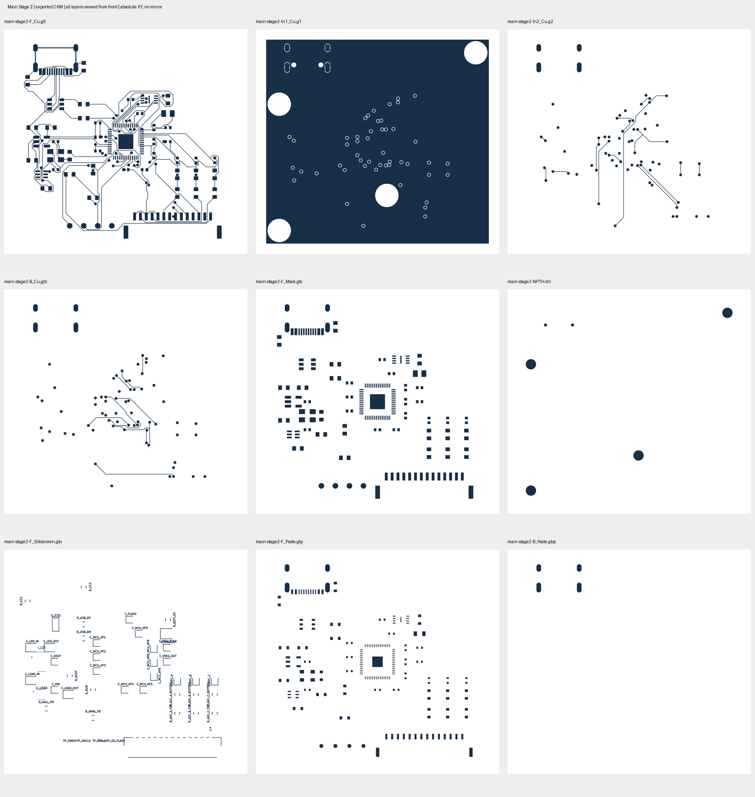

# Issue #155 — Main 機構改版 Stage 2：案Aの実装と再資格確認

**48×44mmを維持し、指定4穴と全銅層φ5.0mm予約領域を追加した。局所退避1回は保持範囲の検証で不合格となったが、範囲を固定した全体再配線1回で独立4指標すべて0を達成した。製造データを生成・照合し、改版後のPOFV再分類とBOM/CPLを作成した。** 製造者の工程受入れと実物の機械・電気評価は未了であり、製造GOではない。発注・課金・mergeはしていない。

[Issue #155](https://github.com/ihsinoky/he-piantor-42/issues/155) と2つの実行指示書を全文確認した。以下Eは[今回の証跡フォルダ](../hardware/kicad/qualification/issue-155-main-mounting-stage2/)を指す。

## 1. 再開状態と入力の固定

開始コミットは `d2139eed736984f2cda75bf2644d4a1190ece0a4`。公開前のremote mainとも一致した。前回のランタイム再起動後に残っていたD-023、改版入力、局所配線出力、再充填・DRCを再利用した。局所配線をやり直していない。

通常の `.git` が読取り専用のため、残っていた `.issue155-runtime/git` の `issue-155-main-mounting-stage2` を継続使用した。ランタイムと一時ファイルは `.issue155-runtime/` 内に置き、KiCad／Python／CAM閲覧用依存関係は既存ランタイムを読取り利用した。他Issueの未追跡成果物はコミット対象外とする。

元の記録の時限は実ホストUTC **2026-11-05 19:52:29–23:52:29**。この枠を延長せず継続した。PO決定日・ユーザー指定作業日は2026-11-06であり、ホストUTCとの日付差を混同しない。詳細はE/start.jsonと各process記録に保存している。

| 固定入力 | 扱い |
| --- | --- |
| #121 `evidence/inspection/main-cell1/krt/main.kicad_pcb` | 合格・再充填出力を直接起点とする |
| #121 `evidence/inputs/main-cell1/main.kicad_pro` | 対応する入力側0.10mm projectを維持。KRTが書いた出力projectで資格確認しない |
| #153 `plans.json` と報告§2・§5 | 案Aの4座標、φ2.2 NPTH／全層φ5.0予約、3本の直接干渉を採用 |
| KRT v0.23.8、commit `c64c0db25e6cf23afa6769ee05665c7ea22b3ff2` | #131保存hashにより2,055ソースとRust binaryを再照合。ソース変更なし |

全桁hashはE/inputs.json、input-hashes.json、runtime-revalidation.json、manifest.jsonに保存した。[D-023](decisions.md#d-023---revm1-main-mounting-revision-plan-a-retained-48-x-44-mm-outline)を追記した。元の決定記録本文は変更していない。

## 2. 改版内容と局所／全体配線

外形X76–124／Y78–122、J1=(85,81), 0°、J2=(110,116), 0°を維持した。元49フットプリントの配置・値・全パッド・ネット・原点・シルクとGND zone設定は維持し、取付穴4フットプリントとrule area4個を追加した。元部品の削除・移動は0。シルク逃げは読戻し上不要だった。

| 穴 | KiCad絶対XY mm | ドリル | 全銅層予約 |
| --- | --- | --- | --- |
| H1 | 79,92 | φ2.2 NPTH、無ネット | φ5.0以上 |
| H2 | 121,81 | 同上 | 同上 |
| H3 | 79,119 | 同上 | 同上 |
| H4 | 102,111.5 | 同上 | 同上 |

Wing #131と同じくrule areaのpadsは許可し、機械NPTH自体を禁止銅箔パッドと誤判定しない。一方、既存銅箔パッドは別の形状検査ですべて確認した。tracks／vias／copper pourは禁止し、F.Cu／In1.Cu／In2.Cu／B.Cuへ伝達されることを配線前の実効設定で確認した。

| 試行 | 入力範囲・結果 |
| --- | --- |
| 局所1回（前回出力を再利用） | VBUS／WING_EN／GNDの直接干渉3セグメントのみ除去した入力。ネット接続・異ネット接触・物的DRCは0だが、保持対象68セグメントの同層・同幅・同ネット被覆が失われた。独立4指標は **0／0／0／68** で局所退避として不合格 |
| 全体1回 | 不合格判定後、改版入力から0.10mm線537本とvia66個を除去する範囲をE/global-scope.jsonへ固定。元来の0.20mm線3本は保持し、`--keep-input-copper`で保護。全体配線後の独立4指標は **0／0／0／0** |

両試行とも4層、厚さ1.2mm、配線幅／clearance 0.10mm、via外径／穴0.60/0.30mm、escalation offを維持。F.Cu／In2.Cu／B.Cuを信号、In1.CuをGND plane専用とし、layer costは `[1,-1,1,1]`。各試行の上限は1回・1,800秒。局所不合格後の局所再試行や第三の配線試行は行っていない。実効設定読取りはnet選択・配線より前で停止する検査であり、配線試行ではない。

準備スクリプトの大量削除後のSWIGオブジェクト不整合は、S式による限定削除へ修正した。再充填後の幅読戻しもKiCadのtrack API引数へ修正した。これらの失敗と修正記録はprocessesへ残し、配線の追加試行にしていない。

### φ5.0円の座標丸め補正

最初の256辺外接ポリゴンは整数nm座標への丸めで最小半径が2.499999728mmとなり、理想φ5.0円とのGND充填重なりを約1.45×10⁻⁷mm²検出した。この微小量を許容する閾値緩和は行わず、4ポリゴンの頂点を半径方向へ**0.000004mm（4nm）拡張**した。

この仕上げはE/inputs/finalとruns/finalに分離した。全体配線前入力と出力の対応する4 keepoutノードのみを同じ規則で更新し、配線・viaは一切変更していない。再充填・DRC・独立接続検査・転送検査を改めて実施した。最終最小半径は **2.5000033779mm**、理想φ5.0円に対する全4穴の実充填GND重なりは **0mm²**。詳細はE/reservation-quantization-guard.jsonとverification.json。

## 3. 最終資格確認と穴読戻し

レビュー対象の最終基板は **[E/inspection/final/main.kicad_pcb](../hardware/kicad/qualification/issue-155-main-mounting-stage2/inspection/final/main.kicad_pcb)**、projectは同じ場所のmain.kicad_pro。PCB SHA256は `fdc1a7748f94714e395eb50f3e08c43afa24192ee76eb3d1804a8cba28690222`。local/globalの途中板を製造入力として選ばない。

| 独立指標 | 最終値 | 根拠 |
| --- | ---: | --- |
| 必須未接続 | 0 | KiCad DRC未接続0＋全37ネットの実銅箔graph |
| 異ネット接触 | 0 | パッド・配線・via・実GND充填形状の独立接触検査 |
| 物的違反 | 0 | 元入力側projectでKiCad 9.0.9 DRC |
| 説明不能な転送変更 | 0 | 非配線AST、元0.20mm線の被覆、保持via、keepout仕上げ差分の照合 |

実銅箔graphは#87の形状・接触判定を使い、4層の実membershipと実充填zoneの外周・穴を追加した。ネット名で連結したことにはせず、形状の接触でunionする。197個の既存銅箔パッドと全配線・viaを対象とし、NPTHは導体に数えない。旧2層snapshotにあるvia層表記を4層の代用にせず、KiCadネイティブmembershipを読む。保守的2nmのbounds予選で計算を短縮しても、元の接触述語は変更していない。

V3V3のU1.48／U1.49／U4.5を含む24パッド、GND49パッド（J2.2/4/8/10/12/14の6帰線を含む）、WING_ENのU1.7／R6.1／J2.7はそれぞれ単一成分。USBの各区間とVBUSも全37ネット検査に含む。R6/R7のpull-down、default-off回路、GH14の割当てを維持した。これはUSB波形・ノイズ・ADC settlingの実測合格を意味しない。

最終配線はF.Cu **486本**、In2.Cu **33本**、B.Cu **37本**、In1.Cu信号線 **0本**。幅0.10mm **553本**と保持0.20mm **3本**、via **66個すべて0.60/0.30mm**。ルータ途中集計の67個ではなく書出し最終板の66個を採用した。

DRCの印刷系指摘は既存と同じ**61件**（text_height44、silk_overlap12、silk_over_copper5）。種別・severity・対象UUID集合まで#121と一致し、新規増分0。物的DRC0と印刷指摘0を混同しない。穴周囲では、フットプリント内図形と可視フィールドを含むシルク衝突は0。

| 穴 | 穴縁→板端 mm | φ5予約縁→板端 mm | 最も近い他ドリルまでの穴縁間 mm |
| --- | ---: | ---: | ---: |
| H1 | 1.900 | 0.500 | 3.450 |
| H2 | 1.900 | 0.500 | 14.676 |
| H3 | 1.900 | 0.500 | 9.918 |
| H4 | 9.400 | 8.000 | 2.362 |

公称φ5による表。4nmの安全側拡張は板端余裕を数nm減らす。穴径・位置・非めっき・無ネットを読戻し、全銅層のパッド／配線／via干渉0と充填GND重なり0を確認した。ドリル間は丸穴・長穴を実形状で比較した。外形と穴間配置は元案と一致する。

## 4. 製造データ、POFVとJ1／BOM／CPL

[E/manufacturing/](../hardware/kicad/qualification/issue-155-main-mounting-stage2/manufacturing/)に4銅層・表裏mask／silk・外形・PTH／NPTH分離Excellonを生成した。**main-stage2-fabrication-review.zipは製造レビュー用11ファイル**であり、発注承認ではない。gbrjob、paste、BOM/CPL、画像はZIPと分けた。gbrjobの一般的な材質・仕上げ等を発注仕様へ自動採用しない。

Gerbonara 1.5.0で4層の線端点・幅、via flash位置・径、パッド位置・外接寸法、CAM外形を照合した。In1の実充填との対称差は **0mm²**、φ5予約円との重なりも0。PTHはvia **66丸穴＋J1の4長穴**、NPTHはJ1のφ0.65 **2個＋新φ2.2 4個**。全座標・径・めっき分類が一致し、今回のExcellon丸め変位は0。inline G85長穴はライブラリが未対応のため、tool径と4命令を独立に厳密解析し、製造ファイルのbyteは変更していない。

maskは表197開口、裏4開口。pasteは既存形状を維持し、表189矩形＋裸TP4円＋J1脚4ストローク、裏J1脚4ストローク。底面pasteを「空」と扱わない。TPのpaste印刷要否、POFV上のpaste、J1脚の両面pasteと実工程・ステンシルは製造者の確認対象で、今回最適化・削除していない。

### 改版後の全via再分類

古い25件を単に転記せず、最終66個すべてをネイティブ実効形状で再走査した。位置・net・外径・穴径集合は#137の元66個とも一致することを後から確認した。

| 排他的な観察分類 | 最終件数 |
| --- | ---: |
| 搭載パッド内にvia中心 | 19 |
| 搭載パッド外に中心、穴の一部がパッドへ重なる | 4 |
| 搭載パッドとvia外周銅箔だけが重なる | 1（C5.2） |
| 裸テストパッド上 | 1（TP4.1） |
| paste図形のみ | 0 |
| **対象合計** | **25** |

搭載パッドへの穴重なりは **23件**、裸TPを含む穴対paste重なりは22件。重複観点なので合算しない。全座標・net・pad UUID・paste重なりはE/pofv-reclassification.json、対象CSVはE/pofv-sites.csv。**D-022のエポキシ充填＋銅キャップ（POFV）方針を維持する。** 対象25箇所と全66個台帳を示し、対象限定／全viaの処置範囲、0.60/0.30mmの適格性、4層追加費・納期・mask／pasteを製造者と確定する。J1のPTH脚・NPTHや新取付穴をPOFV対象へ混ぜない。

### J1と組立データ

J1の12 SMD端子・4 PTH脚・2 NPTH、部品C165948、位置・向き・全padを維持した。**同一Economic PCBA内で12端子と4脚を一括実装**するD-022の結論は変わらない。個別の工程、長穴の穴充填／フィレット、検査、表裏paste、追加費、POFVとの同時受入れは未取得。手はんだ予算を追加計上していない。

#124台帳49行の値・footprint・refと最終板を照合し、購入・搭載45部品をBOM.csv／CPL.csvへ出力した。裸TP4点、新H1–H4、仮想PWR_FLAGは購入／搭載対象にしない。旧価格・在庫を今回の確定値として再使用していない。

Gerber／drillとnative-pos-absolute.csvは絶対原点(0,0)、Y上向き。CPLは板の左下 **KiCad (76,122)** を原点とし、**X=KiCadX−76、Y=122−KiCadY**、全45部品top、鏡像なし。両原点を同一と誤記せず、native-pos49行とCPL45行の変換を全件照合した。J1のCPL位置は(9,41)、J2は(34,6)、回転はいずれも0°。JLC部品ライブラリ固有の回転・極性・EPの配置プレビュー承認は残る。

## 5. 機械・電気評価の残課題

取付けはM2通しねじ＋絶縁スペーサ、頭・座金・接触ボスの投影外径φ4.5以下、皿もみなし。φ5との差の公称半径余裕0.25mmへ偏心・穴位置・ボス位置・座金公差を納める必要がある。H1/H2/H3のφ4.5頭縁→板端は0.75mm。新たな部品・ドリルとの公称平面干渉はないが、実ねじ・ボス等の3Dモデルや締付け条件は未提供である。

4穴中心の支持多角形に対してJ1フットプリント原点は外側 **9.121mm**、J2原点は外側 **9.170mm**。これは実荷重点やたわみの計算ではないが、非矩形4点締結だけで挿抜荷重を安全に受けられるとの主張はできない。USB／GH挿抜時の補助支持、1.2mm板の変形、はんだ接合部のひずみを実物で確認する。追加絶縁支点を使う場合は銅箔・via・下面はんだ・TPアクセスを避ける。

H4のφ4.5頭は#153の仮GHサービス矩形から0.75mm、仮φ6工具は同矩形に接する。GHハーネスを外す組立順序と実工具のアクセスを確認する。J1下面の4脚フィレットとボス高さ、POFVキャップ／パッドへの絶縁部品の接触、ねじ長・締付けトルク・基板反りも未検証。実プラグ・ハーネスの体積が不明なので3D干渉合格とはしない。

GND49パッドの接続とplaneの4穴抜きは成立したが、帰路インピーダンス、USB品質、ADCノイズ／settlingは実測していない。D-017のGH14割当て、100mm・14本1:1の代表ハーネス、6本のGND帰線、HALL_5V default-off、pull-down、TP1–TP4を維持した。二バンクMainへの電気改版ではない。

## 6. 証跡と公開

E/verification.jsonで最終独立指標、厳密φ5予約、全体配線後の4nm補正限定、#121と同一の印刷61指摘、KRTソースと既存ファイルの保全を確認した。保全対象 **10,271ファイル**はD-023の許可追記を除いて変更0。失敗・中断した検査も削除せずprocessesに残した。再現方法と成果物の区別は[E/README.md](../hardware/kicad/qualification/issue-155-main-mounting-stage2/README.md)に記載する。

この報告・D-023追記・今回の証跡だけを選択して作業ブランチへコミットした（実装コミット `eb20fbebde85cad573e6e71b0e7e725706e9fa73`）。pushはHTTPS認証情報がなく `could not read Username for 'https://github.com': terminal prompts disabled` で失敗した。ユーザー指定の「pushできない場合はコミット済みで報告」に従って公開を停止し、**remoteブランチとDraft PRは未作成**。失敗記録はE/processes/publication-push、公開状態はE/publication.json、準備済みPR本文はE/draft-pr-body.mdに保存した。公開失敗の記録も同じブランチへ追加コミットする。発注・課金・mergeは行っていない。
