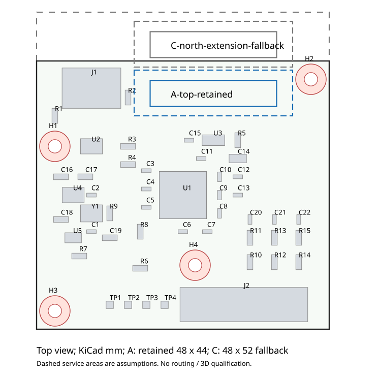

# Issue #157 — Main 2 Wing 接続化 Stage 1：実現性とインタフェース定義案

**第2 GH14を上辺側へ置く案は、D-023の4穴と48×44mm外形を維持して平面上成立する。電気方式は「共通電源・共通アドレス・共通3 ADC経路・独立EN×2」を推奨する。ただしハーネス操作領域の公差と電源の最低保証は未成立であり、配置／配線／製造の合格判定ではない。** 現行Mainの0.10mm電源経路を単に分岐するだけでは、127mA/枚の計画負荷でも低電圧側の感度条件でセンサー4.5Vを割る。Stage 2では電源経路の低抵抗化と再資格確認を必要条件とする。

[Issue #157](https://github.com/ihsinoky/he-piantor-42/issues/157) と `.issue157-runtime/instructions-157.md` を全文確認した。報告書と新規証跡のみを追加した。基板・回路・既存文書の変更、再配線、製造データ生成、発注、課金、mergeは実施しない。以下 **E** は [今回の証跡](../hardware/kicad/qualification/issue-157-main-dual-wing-stage1/) を指す。

## 1. 入力と判定の範囲

remote mainは **`a11c1f7d535241e65b54dc8bb7a27bbf949cf250`**、[PR #156](https://github.com/ihsinoky/he-piantor-42/pull/156) はmerged。手元の通常 `.git` は `d2139ee` のままで、#155のファイルが未追跡、D-023が作業差分として残っていた。このため通常 `.git` を変更せず `.issue157-runtime/git` に管理領域を複製し、最新mainをfetch、indexを照合して **`issue-157-main-dual-wing-stage1`** を最新mainから作成した。最新mainに対する既存追跡ファイルの差分は0。ユーザーの他Issue未追跡成果物も保持し、今回のコミットに含めない。

| 固定入力 | 今回の扱い |
| --- | --- |
| [#155報告](issue-155-main-mounting-stage2.md)、[最終PCBと入力側project](../hardware/kicad/qualification/issue-155-main-mounting-stage2/inspection/final/) | `inspection/final/main.kicad_pcb` を直接読取り。PCB SHA256 `fdc1a7748f94714e395eb50f3e08c43afa24192ee76eb3d1804a8cba28690222`。local/globalの途中板を使わない |
| [D-017／D-019／D-022／D-023](decisions.md) | 現行の決定は変更しない。D-017拡張の追記案を§7に隔離 |
| [Main/Wing契約](../hardware/rev-m1/main-wing-interface.md)、[G0B凍結](../hardware/rev-m1/g0b-freeze-proposal.md) | ピン・6帰線・100mm/14本1:1・3出力を継承 |
| [#141電源評価](issue-141-wing-power-integrity.md) と保存抵抗網解 | 16/17mm、0.30mm電源・GND、5/11mA、20/125°C、公称/−20%幅の16ケースを再使用。16.5mmや最終左右Wingは未評価 |
| [既存GH14ネイティブ定義](../hardware/tscircuit/src/qualification/JstGh14.tsx) | #155 J2の実ランドと照合し、本体・ランド寸法を用いる |

`E/inputs.json` に全桁hashを保存。通常の基板資格確認とは別に、S式読取りとKiCad 9.0.9の読取りAPIを突き合わせ、53フットプリント、203パッド、GH16ランド、4個のφ2.2 NPTH、外形を確認した。候補矩形を既存197銅箔パッドの実効形状とも照合した。仮想フットプリントを基板へ挿入したり、保存・充填したりしていない。

## 2. 必要信号と回路方式

現行物理refは **J2=`J_WING`**、U1=RP2040、U5=TPS22919DCKR。現行基板にはGH14が1個、`WING_EN`が1系統だけある。G0Bおよび[Hall acquisition §4](hall-acquisition.md#4-reva-wing-multiplexing-baseline)の論理構成は、当初から2バンク×3 MUX、共通3 ADC経路、独立ENを想定している。今回の拡張はその第2物理ポートを定義するもの。

| 項目 | 第2系統に必要なもの／共有関係 |
| --- | --- |
| コネクタ | 仮ref **J3=`J_WING_R`**。J2を論理L/Bank0、J3を論理R/Bank1とする。上下に配置しても論理L/Rはこの表で固定する |
| HALL_5V | J3.1へU5出力を分岐。両Wingを常時給電し、U5で全体を一括off。ENによるHall給電遮断は行えない。推奨はU5出力近傍からの2分岐で、J2からの細いデイジーチェーンや単純Yケーブルを採用しない |
| GND | J3.2/4/8/10/12/14をMain共通GNDへ。両Wing合計12接点・12本の帰線。アナログと電源の専用導体は維持するが、別GNDネットや絶縁系にはしない |
| MUX_A0/A1/A2 | J2/J3で共有。U1.4/5/6（GPIO2/3/4）の既存出力を分岐。3 MUXから6 MUX＋2本のケーブルへ負荷が増えるため、立上り・リンギング・GPIO負荷・制御帰路を再評価 |
| WING_EN | **独立2系統必須**。J2.7の既存`WING_EN`を論理`MUX_EN0`と呼び、U1.7=GPIO5、R6=100kΩを保持。J3.7は新ネット`MUX_EN1`、候補U1.8=GPIO6（実PCBで無ネット）＋新100kΩ外付けプルダウン。最終値は漏れ・ノイズ・遷移実測で確認 |
| MUX_OUT_A/B/C | J3.9/11/13を既存の同名raw MUXバスへ接続。各バスはMainの既存6.8kΩ/10kΩ＋1nFを通りADC_A/B/C→U1.38/39/40（GPIO26/27/28）。新ADCや分圧3組は基本案では不要 |
| HALL_PWR_EN | U1.9=GPIO7→U5.3とR7=100kΩを保持。GHへ引き出さず、`WING_EN`と混同しない |
| 追加検出線等 | Wing給電用3.3V、present/ID、追加referenceは設けない。GNDの転用禁止。必要となった場合は再度インタフェース審議 |

GPIO番号とパッケージ端子番号は[Raspberry Pi RP2040 datasheet §5.5.1](https://datasheets.raspberrypi.com/rp2040/rp2040-datasheet.pdf)で確認し、基板ネットと照合した。GPIO6はソフト上の空きだけでなく、U1.8が無ネットであることを確認済み。Stage 2でsourceのNC指定も正しく解除し、端子取り違えと未接続除外の残存を防ぐ。

**共通ENは却下する。** 両Wingのraw出力が同じ3バスを駆動し、異なるHall出力同士を接続してしまう。独立した6 ADC系も現行RP2040の3経路維持方針から外れる。Wingごとに電源スイッチを追加する案は、異常切離しには利点があるが、起動遅延・部品・面積・電源断時のバス挙動の追加検討を要するため基本案に含めない。

## 3. 第2コネクタ配置の実現性

座標はKiCad絶対mm、上面視X右／Y下、原点は既存J2と同じ「信号ランド列中央」。0°のまま、pin1は+X側、本体・固定ランドは+Y側。左右ポートの電気対称性は、基板上での幾何鏡像を要求しない。



| 案 | 仮J3原点／外形 | 結果 |
| --- | --- | --- |
| **A：上辺空き領域（第一案）** | **(105,81), 0°**、X76–124/Y78–122＝**48×44mm** | 全既存部品・J1/J2・4穴を固定して平面上配置可能。本体・ランド・0.5mm組立包絡・仮サービス矩形とも既存部品／予約円と重なり0。配線可能性と3D組立は未認定 |
| B：下辺でJ2の左へ並設 | (89,116), 0°、48×44mm | H3予約円に本体が入り、TP1–TP4とJ2側領域にも干渉。候補として棄却。これをもって全ての他配置が不可能とはしない |
| **C：北へ8mm拡張（代替）** | **(105,73), 0°**、X76–124/Y70–122＝**48×52mm** | 既存4穴と部品座標は固定。サービス矩形の最寄り既存領域への余裕1.5mm、最寄りH2予約円余裕1.1055mm。機械余裕を増やす具体案だが、D-023外形の変更承認が必要 |

### 第一案Aの寸法と干渉

| 形状 | 絶対矩形 Xmin/Ymin–Xmax/Ymax mm | 最小板端余裕 | 最小φ5予約円余裕 |
| --- | --- | ---: | ---: |
| GH本体20.75×4.25 | 94.625/81.200–115.375/85.450 | 3.200mm | 3.128550mm（H2） |
| 全16ランド外接 | 94.525/80.150–115.475/85.750 | 2.150mm | 3.024996mm（H2） |
| ランド外接＋周囲0.5mm組立包絡 | 94.025/79.650–115.975/86.250 | 1.650mm | 2.524996mm（H2） |
| #153と同じ仮GHサービス26×7.5mm | 92.000/79.500–118.000/87.000 | 1.500mm | **0.499996mm（H2）** |

余裕の表は理想φ5円を4nm拡げた半径2.500004mmを基準にする。実際の#155外接ポリゴンは円と完全一致しないため、保存済み4個のrule-areaポリゴンとの重なりもnative APIで別途確認し、案Aはすべて0だった。H1/H3/H4を含む円基準の個別距離は `E/geometry.json`。部品は実パッド外接＋0.5mmを仮の占有包絡とし、実基板のF.CrtYd線分、J1/J2仮サービス領域も別に確認した。完全なメーカー3Dモデルや認定courtyardとは区別する。

サービス矩形とR2の仮占有包絡の最小間隔は **0.025mm**。本体／ランドの最寄りR2包絡までの間隔は2.650／2.550mmあるため、これは直ちに実部品干渉を意味しないが、操作余裕としては確定できない。実GHRハウジング、ラッチを押す指・工具、ケーブル曲げ半径・ストレインリリーフ、USBプラグ、H2ねじ頭φ4.5・ボス・工具、公差を重ねて確認する。無根拠にサービス矩形を縮小して合格扱いしない。成立しなければPOへ案CまたはR2等の移設案を提示する。

案Cは面積2112→2496mm²（**+18.18%**）。48×52mmも100×100mm以内だが、裸基板価格据置きや料金閾値通過を保証しない。旧上辺が板内へ入るため、既存J1のUSB挿抜経路を筐体側の開口／支持と合わせて再確認する。既存4穴を移動しないので旧ボス座標を使える一方、北側筐体・リブ・ハーネス経路・ねじ支持から外れる追加張出しを変更する。案Aでも新J3の挿抜荷重は#155の支持多角形確認を引き継ぎ、上面プラグ高さと蓋のクリアランス、1.2mm板のたわみを評価する。

## 4. インタフェース／ハーネス／走査契約の案

### 4.1 ポートのピン配列

J2/J3とも `BM14B-GHS-TBT(LF)(SN)`、ハーネス両端 `GHR-14V-S`＋`SSHL-002T-P0.2`。次の表を**メーカーの回路番号**で定義する。基板を鏡像に置いた場合でも、見た目の線順で番号を反転しない。

| pin | J2：L／Bank0 | J3：R／Bank1 | Mainからの方向 |
| ---: | --- | --- | --- |
| 1 | HALL_5V | HALL_5V（共通、別分岐） | 電源出力 |
| 2 | GND_PWR | GND_PWR | 共通GND帰線 |
| 3 | MUX_A0 | MUX_A0（共有） | 3.3V制御出力 |
| 4 | GND_CTRL | GND_CTRL | 共通GND帰線 |
| 5 | MUX_A1 | MUX_A1（共有） | 3.3V制御出力 |
| 6 | MUX_A2 | MUX_A2（共有） | 3.3V制御出力 |
| 7 | WING_EN＝MUX_EN0 | WING_EN＝MUX_EN1 | **独立**3.3V、active-high |
| 8 | GND_A | GND_A | 共通GND帰線 |
| 9 | MUX_OUT_A | MUX_OUT_A（共有バス） | rawアナログ入力 |
| 10 | GND_A | GND_A | 共通GND帰線 |
| 11 | MUX_OUT_B | MUX_OUT_B（共有バス） | rawアナログ入力 |
| 12 | GND_A | GND_A | 共通GND帰線 |
| 13 | MUX_OUT_C | MUX_OUT_C（共有バス） | rawアナログ入力 |
| 14 | GND_A | GND_A | 共通GND帰線 |

`GND_PWR/CTRL/A`は役割の名前で、別電気ネットではない。GHの補強ランド2個（現J2はpad15×2）は信号接点／GND追加接点に数えず、NC機械ランドとして維持する。

### 4.2 誤挿入防止とG0Bの扱い

[JST GHメーカー資料](https://www.jst-mfg.com/product/pdf/eng/eGH.pdf)の極性付きシュラウドとラッチを用い、各PCB・ケーブル図・検査治具にpin1を表示する。カタログの1A表記はAWG26条件であり、G0BのAWG28完成ケーブルの定格保証へ自動拡張しない。実ハーネスの受入れ確認を残す。

同型GH14同士では、**L/R差し替えをコネクタ自身で阻止できない**。ピン互換なので入替えだけで5V/GNDが逆転することはないが、論理左右・校正対応が入れ替わる。基本案はL/Bank0、R/Bank1を両端ラベルとケース内経路で固定し、組立治具で左右キー入力を照合する。色・ラベルは識別手段であり物理的排他ではない。物理的に入替え不能を要求する場合は、ケース側の非対称捕捉ガイド／独立経路を実物で検証するか、異種キーの採用を別途審議する。ハーネスの配線反転で左右を区別する案は採用しない。

各ポートに**100mm公称、28AWG目標、14本個別、完全1:1**のG0B代表ケーブルを1本ずつ使用する。2本で計28導体、4ハウジング、56圧着接点。既存の1ポート構成に対する追加は1ケーブル、2ハウジング、28接点である。6帰線を束ねて削減しない。GHプラグの向き・完成長・線抵抗・圧着・引張・全28経路の導通と誤配線／短絡を検査する。100mmは評価用凍結条件で、最終製品の左右長を確定するものではない。長尺化／非対称化したら最長構成で電源・settling・干渉を再評価する。ホットプラグは未認定とし、初期評価は電源offで抜挿する。

### 4.3 ファームウェア走査への要求

次は実装コードではなくインタフェースの必須条件案である。

1. リセット／BOOTSEL／起動時は外付けPDでEN0=EN1=0、HALL_PWR_EN=0。GPIOの出力値をlowへ準備してから出力化する。USB電源予算の使用許可と電源立上り安定を確認するまで両ENを有効化しない。EN0/1の内部pullだけに依存しない。
2. バンクまたはアドレス変更の前に**両ENをlow**へし、実際の旧Wing出力がoffになるブランキング時間を設ける。次にA[2:0]を設定・安定させ、片方のENだけをhighにする。二つのTMUXパッケージ／Wing間の排他はFWの責務であり、IC内のbreak-before-make機能では保証されない。
3. ケーブル2本、無効側MUXの漏れ／容量、Main分圧・フィルタを含むsettling後にADC0→1→2を取得する。3本のアナログ経路は並列だが、RP2040内蔵ADCは順次変換であり同時サンプリングを約束しない。必要なダミー変換、ADC切替後遅延、ノイズ窓を測定で決める。
4. Bank0/1それぞれアドレス0–6、A/B/C各7キー＝**2×7×3=42サンプル/フレーム**。アドレス7=S8は未接続入力で、通常キーとして読まない。キーIDは(bank,address,group)から固定し、左右反転はキー配置表で扱う。
5. 割込み・DMA・複数coreからのEN操作を単一の状態機械で所有し、同時high状態を禁止する。FW異常・USB suspend・電源off移行では両ENlow→HALL_PWR_ENlow。電源未安定時のアナログ入力・制御逆給電とリセット時のEN波形を実測する。
6. 片Wingだけの構成は設定で使用バンクを限定する。present/ID線がないため、浮いたADC値だけで自動接続検出を保証しない。無効側を常にoffにし、校正値・極性・温度変動・左右取り違えをバンク別に検証する。

初期FWの**測定開始値**はブランキング1µs、EN／アドレス確定後settling50µsを提案する。分圧のThevenin抵抗 `6.8k||10k=4.048kΩ`、1nFでτ≈4.05µs、理想一次系が12bitの0.5LSB以内に入るのは約9.01τ≈36.5µs。ただしこの計算はケーブル容量・MUX・Hall出力インピーダンス・ADC取得過程を含まない。[TMUX1208 datasheet](https://www.ti.com/lit/ds/symlink/tmux1208.pdf)の試験負荷でのswitching値をFW待ち時間の実測代用にしない。

参考として変換を2µs/個と仮定すると `14×(1+50+3×2)=798µs`、約1.25kフレーム/s相当。これは[Raspberry PiのADC上限500ksps](https://datasheets.raspberrypi.com/rp2040/rp2040-datasheet.pdf)を使った算術目安で、ダミー変換・制御／USB処理を含む達成値でも承認された性能要件でもない。Stage 2後のG2評価でsettling許容誤差と必要フレーム率を確定する。

## 5. 2系統の電源インテグリティ

### 5.1 電流とTPS22919

| 負荷条件 | 1 Wing | 2 Wing常時給電 | 1.5Aに対する割合 |
| --- | ---: | ---: | ---: |
| G0B typical：Hall 3mA×21＋MUX typ | 63.00006mA | 126.00012mA | 8.40% |
| Hall 5mA＋MUX max 2.7µA×3 | 105.0081mA | 210.0162mA | 14.00% |
| G0Bの20% allowance、Wingごとに切上げ | **127mA** | **254mA** | **16.93%** |
| #141の保守包絡：Hall 11mA＋MUX max | 231.0081mA | 462.0162mA | 30.80% |
| 同包絡に20% allowance、各278mAへ切上げ | 278mA | 556mA | 37.07% |

現在の[TI DRV5055 Rev.C §5.5](https://www.ti.com/lit/ds/symlink/drv5055.pdf)は5V、B=0mTで3mA typ／5mA max。11mAは#141で残した保守的な感度包絡であり、今回メーカーmaxを11mAへ読み替えない。3 MUXの2.7µA条件はG0B／#141を継承し、3.3Vロジック実駆動時の総電流は別途実測する。最終センサー選択も未確定である。

[TI TPS22919 Rev.B](https://www.ti.com/lit/ds/symlink/tps22919.pdf)の連続電流1.5Aに対して、定常合計には部品定格上の余裕がある。5VでRON typ89mΩ、25°C最大125mΩ／125°C最大200mΩ。今回の電圧感度表は3.6V試験点の最大値150／250mΩを保守仮定として採用し、20°C計算には25°C値を用いる。4.75Vでの保証補間ではない。254mA時の250mΩ損失は16.13mW、556mA時は77.28mW。熱・過渡の実機合格ではない。

1.5AはUSBから許可される電流ではない。MainのRP2040・flash・LDO等、USBケーブル／接点損失、USBの起動・列挙・suspend時の許可電流は別に予算化する。短絡保護の典型値を通常動作電流として使用しない。ENを交互にしてもHall42個は給電されたままである。

### 5.2 拡張モデルと境界

`E/analyze.py` は#141の保存済み線形抵抗網解を読み、各Wing内部の電源降下とGND上昇の和をそのまま使う。さらに127mA／278mAの計画負荷は同じ全負荷分布を線形比例拡大した。**各Wing内部や各ハーネスの降下を単純に2倍にはしない。共有経路だけが合計電流を負う。**

```text
USB/J1 → Main VBUS → U5 VIN → TPS22919 → 共通HALL供給点
                                        ├→ Main枝L → harnessL → WingL
                                        └→ Main枝R → harnessR → WingR
GNDも共通部分と各枝の帰路を持つ

Vlocal_i = Vsource - (IL+IR)*(Rswitch+Rcommon)
                    - Ii*(Rmain_branch_i+Rharness_i) - ΔVwing_i
```

主CSVの`Vsource`は**U5 VIN対Main GND**、`Rmain_common_loop_ohm`は未知のMain銅箔／GND損失を0/0.25/0.5Ωで振る等価感度パラメータである。対称負荷の場合、枝抵抗RbranchはRcommonへRbranch/2として等価に含められるが、実物の共通／枝抵抗の分離抽出ではない。実測値と混同しない。別証跡のMain経路加算表では、これを0とした行にVBUSとHALL既存経路を明示加算する。

ハーネスは100mm、28AWG断面積0.0804mm²、銅ρ20=1.7241×10⁻⁸Ωm、温度係数0.00393/K。線材片道20°Cで0.021444Ω、1導体の両端2接点を数える。接点30/50mΩ、帰路6本等分／1本集中を感度化し、`Rharness=(Rwire+2Rcontact)*(1+1/Nreturn)`。50mΩ・6帰線では20°Cで0.141685Ω、125°Cで0.152009Ω。圧着抵抗・実線径・接点温度依存は未測定。6本均等分担の保証もないため1本帰路のケースを残した。

#141の35µm銅・20µm via barrel・パッド拡がり・製造後接触トポロジ保持などの近似を継承する。125°Cは抵抗の感度条件であり、GH／TPSの推奨周囲温度を超える125°Cでシステム動作を認定しない。主計算768行は `E/dual-wing-dc.csv`、条件と要約は `E/power-model.json`。

### 5.3 結果：電源最低値の追加確定が必要

下表は両Wing同負荷、50mΩ/接点、6帰線、Main未知損失0Ω、U5入力4.75Vまたは5.00Vとした感度例。**#141の4.75VはWing到達後の境界だったが、本表はU5入力へ移しており、ケーブル／スイッチをここで初めて差し引く。** 4.75VがUSBやU5で保証されるとの主張はしない。

| Wing | 負荷/枚 | °C・電源線幅条件 | Wing内部ΔV | harnessΔV | 共有switchΔV | 局所@4.75V | 局所@5V |
| --- | ---: | --- | ---: | ---: | ---: | ---: | ---: |
| 16mm | 105.0081mA | 20・公称0.30mm | 0.04752 | 0.01488 | 0.03150 | 4.65610 | 4.90610 |
| 17mm | 105.0081mA | 20・公称0.30mm | 0.06990 | 0.01488 | 0.03150 | 4.63372 | 4.88372 |
| 16mm | 105.0081mA | 125・0.24mm | 0.08322 | 0.01596 | 0.05250 | 4.59831 | 4.84831 |
| 17mm | 105.0081mA | 125・0.24mm | 0.12213 | 0.01596 | 0.05250 | **4.55940** | 4.80940 |
| 16mm | 127mA計画 | 125・0.24mm | 0.10065 | 0.01931 | 0.06350 | 4.56655 | 4.81655 |
| 17mm | 127mA計画 | 125・0.24mm | 0.14771 | 0.01931 | 0.06350 | **4.51948** | 4.76948 |
| 16mm | 231.0081mA包絡 | 125・0.24mm | 0.18308 | 0.03512 | 0.11550 | **4.41630** | 4.66630 |
| 17mm | 231.0081mA包絡 | 125・0.24mm | 0.26869 | 0.03512 | 0.11550 | **4.33069** | 4.58069 |

電圧単位V。17mm・127mA条件ではMain損失を除いても4.5Vまで19.48mVしか残らない。許容Main等価loop抵抗は **0.07671Ω**、0.25Ωを入れると局所 **4.45598V**。17mm・11mA包絡は20°C公称でも4.49420Vとなり、4.75V源ではこの感度仮定で不足する。これは部品電流容量とセンサー到達電圧が別の問題であることを示す。

### 5.4 #155の実配線からの追加評価

単なる未知パラメータだけにせず、`E/main-resistance.py` で#141の`model()`を変更せず再利用し、#155 snapshotのパッド・配線をnative PCBと照合、viaの実4層membershipをnative APIで読み、1Aテスト電流で既存Main正電源経路の抵抗を見積もった。新規配線は作成していない。

| 現行Main経路 | 線/ via数 | 20°C公称 | 125°C・−20%幅 |
| --- | --- | ---: | ---: |
| J1.2/11→U5.1 VBUS | 31本／2個、線0.10mm | 0.14460Ω | 0.25433Ω |
| U5.6→J2.1 HALL_5V | 9本／2個、線0.10mm | 0.22945Ω | 0.40429Ω |

Main GND plane抵抗・MCU/LDO等のVBUS負荷はこの抽出に含まない。17mm・127mA/枚、125°C、−20%幅の例で、U5直後から新枝へ分岐して旧J2枝は従来の127mAだけを通す場合でも、旧HALL枝で51.34mVを失い、U5 VIN=4.75Vに対して旧J2側センサーは **4.46814V**。さらにJ1側4.75Vを境界とするとVBUSで64.60mV失い、**4.40354V**。同じJ1側5.00Vでは4.65354Vとなるが、GND／他負荷／USB上流を除く感度例である。

J2でY分岐し既存HALL経路へ254mAを通すと、同条件のJ1側4.75Vに対して旧J2側は **4.35220V**へ悪化する。したがって第2コネクタを足すだけ／外付け分岐だけを電源成立案とはしない。`E/main-resistance.json` は8抵抗ケースと64経路感度ケースを保存する。新J3の正電源枝・共通GND・左右同時負荷の実抵抗抽出はStage 2の配線後に必要である。

推奨は、Stage 2のPO確認項目に **Main VBUS/HALL供給経路の拡幅・短縮／低抵抗分岐、GND planeの連続性**を明記し、D-019の信号0.10mmとは別に電源線幅を承認すること。0.30mmはWingで効果があった候補値であり、Mainの合格必要幅を今回確定したものではない。U5の定格だけから配線の電流容量・温度上昇合格を推論しない。

### 5.5 起動・実測ゲート

#141の各WingはHall21個＋MUX3個それぞれ100nF相当の計24個で2.4µF/枚、Main C19=1µFを合わせた公称接続容量は概算5.8µF。未計上容量・DCバイアス・配線・USB入力容量を別に含める。3.2mV/µsというTIの典型slewを使えば容量充電だけで約18.56mAだが、実際のセンサー起動電流とUSB動作はこの式では決まらない。容量を増やすだけの解決や定常電流のみでの起動合格を採らない。

2 Wing同時接続で、U5 VIN/OUT、Main/左右WingのHALL_5VとGND、最遠Hall局所電源、電流、ADC基準を測定する。通常／低VBUS／全キー入力／片Wing接続／起動・停止／EN切替、温度・最大製品ケーブル長を含め、局所4.5V以上の設計下限と上限5.5V・ADCクリップ余裕、GNDオフセット、settling・ノイズ・他Wingからの結合を確認する。測定結果によって供給最低値・負荷上限・幅・電源構成をPOが確定する。

## 6. D-019／D-022への影響とStage 2手順

| 対象 | 影響と保留事項 |
| --- | --- |
| D-019 | Main 4層／1.2mm、F.Cu/In2/B.Cu信号・In1 GND、clearance0.10mm、via0.60/0.30mmを基本に継承。第2コネクタ・EN・長いrawバスと供給枝で新たな配線問題となり、#155の合格は引き継げない。電源線幅変更は承認する範囲を明示。48×52案ならD-023外形と見積り条件も変更 |
| D-022：POFV | epoxy充填＋銅cap方針を維持し、via回避を目的とする改版へ勝手に切り替えない。#155の66via／25観察／搭載パッド穴重なり23は旧板の台帳であり、第2系統改版後は全viaを再分類。新GH固定ランド・EN PD近傍の穴／pasteも対象。J1 PTH／全NPTHは充填対象から除外 |
| D-022：J1 | 同じEconomic PCBAでSMD端子＋4 PTH脚を一括実装する方針を維持。J1を固定しても新CPL／paste／工程プレビューは再確認。Standardへの変更や手はんだ費の再加算を決めない |
| D-023 | 4穴φ2.2と全銅層φ5.0以上予約を固定。案Aは外形・既存部品配置も保持可能。新部品・ネット・配線追加は「既存電気インタフェース保持」の将来例外となるため、§7の承認範囲で扱う。案Cは外形の追加承認が必要 |

基本案のMain増分は **GH14×1＋100kΩ PD×1＝購入搭載2部品/枚**。#155の53フットプリント（購入搭載45＋TP4＋穴4）から仮に55（購入搭載47）になる。追加GHは14信号ランド＋補強2、抵抗2で、幾何上の追加SMT接合候補18箇所/枚、5枚で10部品・90箇所。ただし実PCBA課金は端子定義／工程による。Wing基板BOMは基本案で変更しないが、製品全体では2枚目Wingの部品・基板・組立費と追加ケーブルが必要になる。

部品価格・在庫・Basic/Extendedの現行値や見積りは今回は取得していない。[#124の価格](issue-124-main-bom-pcba-estimate.md)やD-019の裸基板$8は履歴であり今回総額へ転記しない。Main増額は「GH＋PD部品代＋実装増分＋必要なら追加Extended種別費＋POFV再見積＋機械変更」、ケーブルは別計上。既存と同一MPNなら通常は種類追加を抑えられるが、GH等の組立区分・調達方法・フィーダー費重複の有無は未確定。デカップリング／電源部品追加が必要なら2部品という最小見積を更新する。発注／課金操作は行わない。

Stage 2は以下を**POが本定義案を確認した後**に行う。本Stageで開始しない。

1. ポート対応、GPIO6、共通電源・独立EN、rawバス共有、pin互換、誤挿入方針、100mm×2をPOが選択する。案Aの実機プラグ・ケース・工具・公差を確認し、必要なら案C／部品移設範囲とD-023差分を承認する。電源最低値・許容負荷・電源線幅も作業条件へ固定する。
2. 正式な電気ソース／回路／接続台帳に第2ポート・独立EN PDを追加し、NC解除、全28接点、rawバス、default-offを照合。#155合格板＋対応入力projectから派生し、4穴・全層予約、既存J1/J2、既存部品／非対象ネットの保持範囲を固定する。
3. 新部品配置・電源／GND低抵抗化・配線除去範囲を事前記録する。局所または全体再配線の回数・時限・保持対象をStage 2の指示として決め、D-019条件下で実行。#155の「局所1回→全体1回」を無断で今回の上限へ読み替えない。
4. 再充填・入力projectでDRC、実銅箔接続graph、異ネット接触、転送保持の独立4指標を再取得し全0を要求。新ENが両者に短絡していないこと、全層via membership、GND 12帰線、φ5理想予約、板端・穴・部品・drill・シルクと印刷指摘の増分を確認。
5. Mainの共通／左右枝の抵抗を抽出し、#141のWing負荷・2ハーネスを一体評価。ADC rawバスの二枝スタブ／無効MUX容量を含む測定とFW排他波形、42キー走査・片Wing運用・異常時offを確認。電源の不足条件が残れば配置／製造合格と切り分け、電源成立の承認を保留する。
6. 合格した最終板からGerber／PTH・NPTH drill／mask・表裏pasteを生成し独立CAM照合、全viaのPOFV再分類、BOM/CPL原点と回転／pin1を更新。POFVとJ1を同時に受け入れる製造者の工程・追加費・納期、J3組立条件、実ケーブル・ケースのレビューを完了する。発注判断は別途POが行う。

## 7. D-017拡張の決定記録「追記案」

以下は**未採択の案文**であり、`docs/decisions.md`、G0B、現行インタフェース文書へは追記していない。識別番号はPOが採択時に割り当てる。

> ### D-017 extension — Main dual-Wing physical interface（追記案、未採択）
>
> Issue #157のStage 1を根拠として、Rev.M1 Mainに2個のJST GH14ポートを実装する方針を採用する。J2はL/Bank0、追加J3はR/Bank1とし、いずれもBM14B-GHS-TBT(LF)(SN)、GHR-14V-S、SSHL-002T-P0.2を用いる。両ポートのpin1–14は既存G0Bと同じ割当を維持し、pin7だけを各ポートの独立WING_ENとする。6 GND接点は共通GNDへ接続し、予備信号へ転用しない。
>
> MainはHALL_5V、MUX_A0/A1/A2、MUX_OUT_A/B/Cを共有し、既存の3分圧／フィルタ／ADC経路を使う。U5のHALL_PWR_ENは全Hall給電の共通default-off制御とし、バンクENと分離する。J2のWING_ENはMUX_EN0（GPIO5）、J3はMUX_EN1（GPIO6候補）に対応させ、それぞれMain側の明示的な外付けプルダウンを設ける。GPIO6と追加100kΩは実装候補とし、Stage 2のsource・漏れ／ノイズ検証で確定する。
>
> FWは常に両ENをoffにしてからアドレス／バンクを変更し、出力off・settlingを待って片ENのみを有効化する。42キーは2バンク×7アドレス×3 ADCで走査し、同時ENを禁止する。reset・電源未安定・suspend／異常時のoff、片Wing運用、左右キー対応を検証する。
>
> 代表評価ハーネスはポートごとに100mm公称、14本個別1:1を1本ずつ使用する。同型コネクタではL/Rの物理的排他は保証されないため、ラベル・固定経路・組立検査を必須とし、物理排他が必要ならケースガイドまたは別キー案を追加承認する。製品最大長が変われば電源・ADC評価をやり直す。
>
> 機械第一案はJ3=(105,81), 0°、48×44mmを維持する。D-023の4穴座標・φ2.2 NPTH・全銅層φ5.0以上予約を維持する。仮サービス領域は公差合格を意味しない。成立しない場合の48×52mm案や既存部品移設は別途PO承認を必要とする。D-023の既存電気構成保持に対する例外は、承認された第2ポート・EN・必要な電源／信号配線の追加範囲に限る。
>
> 2 Wing計画電流は127mA/枚、254mA合計を維持し、#141の11mA/センサー包絡も感度評価する。TPS22919の1.5A部品定格をUSB予算または局所電源保証へ代用しない。Main電源配線の低抵抗化と共通／枝GND、起動・ハーネス・最遠センサーの電圧、ADCノイズ／settlingを再評価し、条件を満たすまで電源インテグリティ合格としない。
>
> D-019の4層・1.2mm・0.10mm clearance・0.60/0.30mm viaを継承し、電源線幅はStage 2の承認条件で明示する。D-022のPOFVおよびJ1同一Economic PCBA方針を維持し、改版後に全via・BOM/CPL／CAMを再評価する。本記録はStage 2の範囲を定義するもので、既存板の資格を新改版へ移転せず、製造リリース・発注・課金を承認しない。

## 8. 証跡・検証・公開

`E/README.md` に再現方法を記載した。解析スクリプト、実寸法JSON、候補図、native照合、768電源ケース、Main実経路の抵抗／感度結果、参照元とhash、Issue／PR入力、保全確認を保存する。今回実行したのは読取り・解析のみで、ルータ／DRC再資格確認を実行したとの主張はしない。最終の保全・追加限定チェックは `E/verification.json`、公開結果とDraft PR本文は `E/publication.json`／`E/draft-pr-body.md` に記録する。

作業は `.issue157-runtime/` 内のGit管理領域でコミットする。公開はDraft PRのみを試み、push不可の場合はユーザー指示どおりコミット済み成果物と失敗理由を報告する。mergeおよび製造操作は行わない。
