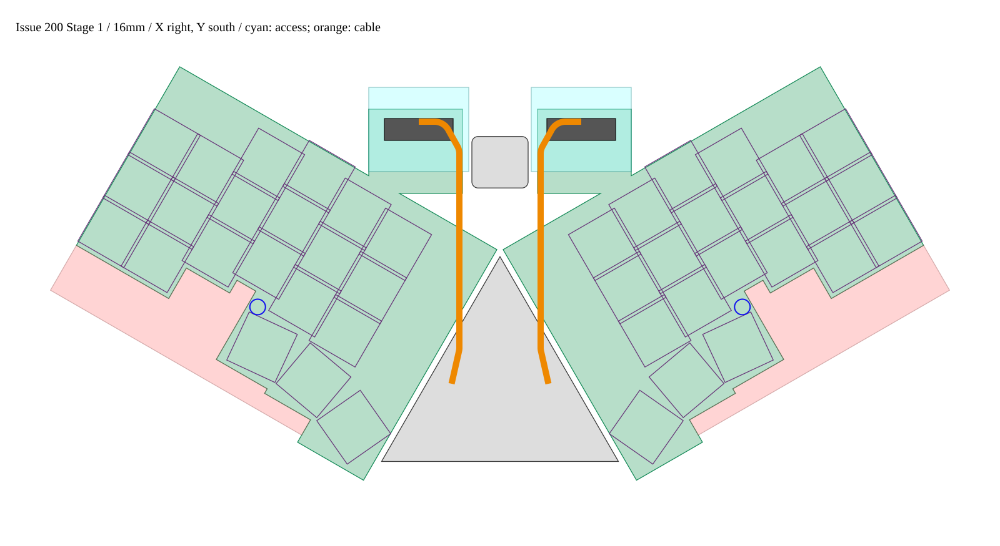
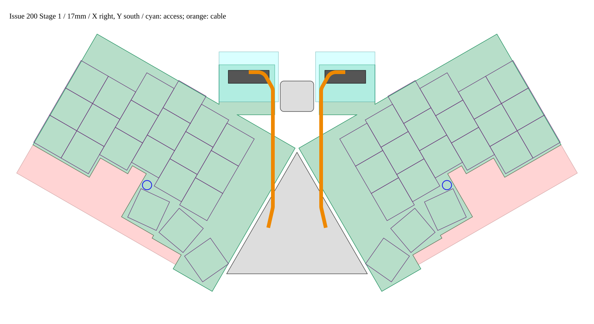

# Issue #200 Wing Rev.3 — Stage 1 形状の実現性検討

両ピッチ×左右について、北タブへの GH 移設・キー列内側を通るハーネス・南側の段付き外形を提案する。公称平面モデルでは基板同士の最小間隔は約 2mm 以上、φ2mm ケーブルと 17mm キーキャップの交差は 0。南トリムは電源配線用の 2mm 余白を確保する。一方でサービス部品群と南外側の穴が影響を受けるため、Stage 2 の再配置・再配線を前提とする。これは形状案であり、配線済み基板・製造資格の更新ではない。

## 入力・座標・再現方法

指定指示書 `.issue200-runtime/instructions-200-stage1.md` を全文読了。作業先は `.issue200-runtime/git`、ブランチは `issue-200-wing-rev3`。ベース `90c8314`。#198 の入力は現ブランチにないため、ローカル参照 `origin/issue-198-case-stage1` の commit `6a596e237d60e5054fb8bfdaf8d39b642b5574a0` から generate.py と両ピッチの dimensions.json を [inputs/issue198](../hardware/case/issue-200-stage1/inputs/issue198/) に byte 保存した。ケースは再生成していない。

Wing は #194 qualification の各 main.kicad_pcb・definition・BOM/CPL と case CSV。Main は #196 Phase A-2 geometry-plan.json と Phase B inspection/final/main.kicad_pcb。UDB C3 は同 A-2 内の実基板を #198 が変換した輪郭（R2 隅丸、外接 18×16.5mm）を使う。#198 が記録した全入力の SHA-256 と作業コピーの入力を照合し一致を検証した。全使用入力の SHA-256 は geometry.json に収録。

ローカルは上面視 X 右・Y 北、角度は反時計回り。組立は X 右・Y 南・Z 上。変換は `assembly = M × local + t`。KiCad Wing 絶対座標は `(100+x,100−y)`。基板下面 Z=10、上面 Z=11.2mm（UDB 上面 11.6mm）は #198 と同じ。

| 版 | M | t |
| --- | --- | --- |
| 16mm-left | [[0.8660254037844386, 0.5], [0.5, -0.8660254037844386]] | (-77.648, 12.558) |
| 16mm-right | [[0.8660254037844386, -0.5], [-0.5, -0.8660254037844386]] | (77.648, 12.558) |
| 17mm-left | [[0.8660254037844386, 0.5], [0.5, -0.8660254037844386]] | (-81.246, 12.791) |
| 17mm-right | [[0.8660254037844386, -0.5], [-0.5, -0.8660254037844386]] | (81.246, 12.791) |

Main J2/J3 は実 Phase B 基板から `(−15.5,43)` / `(15.5,43)` を照合。UDB は組立 bbox `(−9,−36.25,9,−19.75)`、SH J2 は `(0,−20)`。新外形へ合わせた再センタリングは行わない。

再現はリポジトリルートで `python3 hardware/case/issue-200-stage1/generate.py`（Python 3、shapely 2.2.0、sexpdata 1.0.2）。本実施では runtime 内 venv を使用した。出力は [geometry.json](../hardware/case/issue-200-stage1/geometry.json)、[全トリム棚卸し CSV](../hardware/case/issue-200-stage1/trim-inventory.csv)、本報告書と 2 枚の SVG。生成器は PCB を読み取るだけで変更しない。

## 北タブと GH

左タブは組立矩形 `X=−42…−12, Y=−45…−18`、右は X の符号反転。既存北辺と約 27.855mm² 重ねて接続し、新外形との和集合を取る。タブ追加面積は各 782.145mm²。付け根には既存の C4/C5 キーの下へ重なる基材があるが、スイッチ・センサー・脚穴は動かさない。GH の位置は上段キーより北に離す。

位置は現行 footprint のパッド列中心（J_WING 原点）である。長軸は組立 X 方向。既存 footprint を平行移動・回転するだけで、右用もパッドを鏡像化しない。全パッドの番号・net・新ローカル/組立座標は geometry.json の connector.pads に記録した。

| 版 | GH ローカル原点 | 組立原点 | ローカル角度 | 本体/キャップ間隔 | アクセス/キャップ間隔 |
| --- | --- | --- | --- | --- | --- |
| 16mm-left | (17.949, 72.207) | (-26.000, -41.000) | 30 | 12.601 | 4.307 |
| 16mm-right | (-17.949, 72.207) | (26.000, -41.000) | -30 | 12.601 | 4.307 |
| 17mm-left | (20.949, 74.207) | (-26.000, -41.000) | 30 | 13.836 | 5.851 |
| 17mm-right | (-20.949, 74.207) | (26.000, -41.000) | -30 | 13.836 | 5.851 |

BM14B-GHS-TBT は上面から嵌合する。[JST GH 公式図面](https://www.jst-mfg.com/product/pdf/jpn/GH.pdf) pp.2–3 の 14極・1.25mm ピッチ・ベース幅 20.75mm、トップ型の組立断面を参照。既存ランドの取付金具も含め、公称本体を保守的な幅 22×奥行 7mm で包む（左 `X=−37…−15, Y=−42…−35`）。この包絡は新タブ上に全て収まる。JST のベース/ハウジングの寸法と、以下の指・ケーブル作業用の仮定値は区別する。

上面のプラグと指用に左 `X=−42…−10, Y=−52…−25` の 32×27mm を予約する。幅方向に各 5mm、奥行方向に各 10mm を本体包絡へ加え、長辺両側を指先でつまむ想定。右は X 反転。上方は `Z=11.2…41.2mm` の 30mm を開放し、上蓋・支柱・ハーネス固定具を置かない。挿入とロック解除を上面から行える平面/高さ予約であり、人の指寸法や量産プラグ最大外形の保証ではない。実ハウジング・実指による操作、ケーブル引出し曲げ、蓋開口の最終確認を Stage 2 に残す。UDB との作業包絡間隔は 1mm で、UDB 方向へ指を逃がす前提にはしない。

| 版 | 対象 | 基板全体 | タブ | GH 本体 | 指/プラグ包絡 |
| --- | --- | --- | --- | --- | --- |
| 16mm-left | main | 2.000 | 23.554 | 40.173 | 29.044 |
| 16mm-left | udb | 3.000 | 3.000 | 6.035 | 1.000 |
| 16mm-left | opposite_wing | 2.000 | 22.204 | 27.000 | 22.000 |
| 16mm-right | main | 2.000 | 23.554 | 40.173 | 29.044 |
| 16mm-right | udb | 3.000 | 3.000 | 6.035 | 1.000 |
| 16mm-right | opposite_wing | 2.000 | 22.204 | 27.000 | 22.000 |
| 17mm-left | main | 2.000 | 23.554 | 40.173 | 29.044 |
| 17mm-left | udb | 3.000 | 3.000 | 6.035 | 1.000 |
| 17mm-left | opposite_wing | 2.000 | 22.204 | 27.000 | 22.000 |
| 17mm-right | main | 2.000 | 23.554 | 40.173 | 29.044 |
| 17mm-right | udb | 3.000 | 3.000 | 6.035 | 1.000 |
| 17mm-right | opposite_wing | 2.000 | 22.204 | 27.000 | 22.000 |

単位 mm、全て最短平面距離。基板重なり面積は全組合せ 0mm²。Main の約 1.9999993mm は元入力の丸め差であり、約 2mm と報告する。タブとコネクタは UDB/Main/対向 Wing に接触しない。

## 新ハーネス経路

左の組立折れ線は `(−15.5,43) → (−13,32) → (−13,−32) → (−18,−41) → (−26,−41)`。右は X 反転。全角を R5mm の接線円弧へ置換し滑らかにする。円弧の中心・端点・符号付き角度と 0.5° 以下の標本点を JSON に収録した。標本弦の最大誤差は 0.00005mm 未満。検証対象は片側だけでなく両 Wing の全 42 キーの、角度を保持した 17mm 角包絡である。

| 版 | 直線 | 折れ線 | R5 円弧後 | 余裕 | 必要長（折れ線+余裕） | 200mmとの差 | ケーブル表面/キー |
| --- | --- | --- | --- | --- | --- | --- | --- |
| 16mm-left | 84.654 | 93.576 | 92.950 | 30.000 | 123.576 | 76.424 | 7.888 |
| 16mm-right | 84.654 | 93.576 | 92.950 | 30.000 | 123.576 | 76.424 | 7.888 |
| 17mm-left | 84.654 | 93.576 | 92.950 | 30.000 | 123.576 | 76.424 | 9.008 |
| 17mm-right | 84.654 | 93.576 | 92.950 | 30.000 | 123.576 | 76.424 | 9.008 |

長さ・間隔は mm。中心線を半径 1mm で太らせた φ2mm 仮定ケーブルでもキー包絡との交差は全版 0、UDB まで 3mm。必要長は円弧後より長い折れ線長を使い、上下嵌合・曲げ・組立サービス余裕を合わせて 30mm 加算した。200mm を維持すると約 76.424mm が追加で余る。余剰をキー上へ垂らさず、中央/北側へ固定する保持点・ループ半径・14芯束の実径は後段で決める。R5 と φ2 は #198 由来の仮定で、メーカー指定の実ハーネス曲げ半径・束径で再確認する。

経路は Main の上面や中央通路を通る。キー包絡非交差を今回検証したが、Main 実装部品との Z 干渉、上面 GH 出口の立上がり、SH ケーブルとの交差、ケース内での余長収納は未資格。必要長の 30mm 余裕をそれらの合格保証に使わない。

## 南トリムと電源/GND 用の余白

各 15.8mm スイッチ包絡を法線方向へ 2mm 拡張し、その軸平行 bbox を旧北辺まで掃引して和集合を取る。左右端は旧側辺まで延長する。これにより最下段行・親指の高さ差に沿う水平/垂直の段付き南辺になる。回転親指では bbox 化により余白が 2mm より広くなる箇所がある。南辺の全線分は JSON の south_trim_line_local、南辺だけのベース外形は south_base_outline_local に収録。全スイッチが新基材内に入り、南辺から包絡までの実測最小は全版 2.000mm。

D-021 改訂の 2層/1.2mm、信号 0.10mm・HALL_5V/GND 0.30mm・clearance 0.10mm・via 0.60/0.30mm を維持する。2mm の帯には、基板端から 0.30mm の後退、0.80mm の GND 帯、0.10mm の間隔、0.30mm の電源線、0.10mm の余白を並べても 0.40mm 残る。これは新たな端面後退の提案であり D-021 の既定端面規則ではない。F.Cu に HALL_5V、B.Cu に連続 GND を予約し、信号線や via を南辺の帯へ密集させない方針とする。段の内角はオフセット形状に沿って回り込ませ、角で帯を切断しない。

基材を端面から 0.30mm 後退させ、残す/移す穴の φ5mm 予約＋0.10mm を除去した領域は全版で連結している。さらに 0.15mm 内側へ縮めても、全 21 センサー原点と新 GH 原点は同じ主領域に入る。穴と端面の間に生じる細い外側の三日月は縮小後に孤立するため、そこを電源/GND 接続路に使わない。この検証は基材上に連続経路を確保できる根拠であり、パッド・異ネット銅箔・熱接続を含む実 GND プレーンの導通証明は Stage 2 の再配線・ゾーン再充填で行う。現 Rev.2 のプレーンをそのまま切り取って使うことはできない。

最南の親指は Rev.2 で包絡ぎりぎりだったため、2mm 余白を得ると旧南端から最大 2.658mm 南へ張り出す。全域が単なる縮小ではない。この追加も含めた面積と外接寸法を以下に示す。

| ピッチ（左右共通） | 旧外接 W×H | 北タブだけ追加 W×H | 最終案 W×H | 旧面積 | 北追加 | 南削除 | 南追加 | 最終面積 | 差 |
| --- | --- | --- | --- | --- | --- | --- | --- | --- | --- |
| 16 | 117.200 × 82.699 | 117.200 × 116.170 | 117.200 × 118.828 | 9685.588 | 782.145 | 1471.165 | 71.443 | 9068.012 | -617.577 |
| 17 | 123.200 × 86.699 | 123.200 × 120.170 | 123.200 × 122.828 | 10674.681 | 782.145 | 1684.616 | 71.193 | 9843.404 | -831.278 |

寸法は Wing ローカル軸の外接矩形、面積は穴控除前の外形面積 mm²。旧値は確定 CSV/実 PCB 輪郭であり、過去案の公称 83/87mm と区別する。組立軸 bbox は outline_assembly から取得できる。

## トリム域の全棚卸し

トリム域を「旧外形 − 新外形」と定義する。Native PCB の全 footprint/pad、segment（幅を含む）、via（外径を含む）、zone の入力ポリゴンと全 filled_polygon を走査した。部品は実ランドと保守的な本体包絡の和を使い、一部でも削除域にかかれば列挙した。部品包絡は Hall 3×3、0603 1.8×1、MUX 5.1×6.6、GH 22×8、TP 1×1mm とし、実ランドが大きい箇所はその分も含む。実ボディ未確定に対する包絡仮定である。ゼロ面積の接触だけは除外。CSV は native UUID/親index/層/net/交差面積/元 bbox を持ち、切られた銅箔片ごとに原基板へ追跡できる。

### 16mm-left

影響部品（全件）：C_MUX_A、C_MUX_B、C_MUX_C、J_WING、TP_H_CTR_RAW、TP_H_DIAG_RAW、TP_H_N_RAW、TP_W_A0、TP_W_A1、TP_W_A2、TP_W_EN、TP_W_GND、TP_W_GND_A、TP_W_GND_B、TP_W_GND_C、TP_W_H5V、TP_W_MUXA、TP_W_MUXB、TP_W_MUXC、U_MUX_A、U_MUX_B、U_MUX_C。

| 種別 | 影響数 |
| --- | --- |
| pad | 86 |
| segment | 1300 |
| via | 99 |
| zone_fill | 11 |
| zone_outline | 5 |

取り付け穴は実 PCB の reference を採用。CSV の連番と実 reference は右側で一致しない。

| 実 ref | 旧ローカル中心 | φ5 予約がトリム域に接触 | 中心から端面3mmを確保 |
| --- | --- | --- | --- |
| H1 | (-54.100, -30.499) | あり | 不可 |
| H2 | (-54.100, 46.200) | なし | 可 |
| H3 | (57.100, -15.000) | なし | 可 |
| H4 | (57.100, 46.200) | なし | 可 |

| 移設候補 ref | 新ローカル | 新組立 | 端面距離 | φ5予約/スイッチ間隔 |
| --- | --- | --- | --- | --- |
| H1 | (3.000, -5.000) | (-77.550, 18.389) | 3.059 | 0.699 |

影響銅箔の要点（全 net/layer 別明細は JSON/CSV）：

| net | 種別 | 層 | 件数 |
| --- | --- | --- | --- |
| GND | pad | F.Cu,F.Mask | 4 |
| GND | pad | F.Cu,F.Mask,F.Paste | 12 |
| HALL_5V | pad | F.Cu,F.Mask | 1 |
| HALL_5V | pad | F.Cu,F.Mask,F.Paste | 7 |
| GND | segment | B.Cu | 2 |
| GND | segment | F.Cu | 47 |
| HALL_5V | segment | B.Cu | 13 |
| HALL_5V | segment | F.Cu | 11 |
| GND | via | F.Cu,B.Cu | 15 |
| HALL_5V | via | F.Cu,B.Cu | 16 |
| GND | zone_fill | B.Cu | 2 |
| HALL_5V | zone_fill | F.Cu | 9 |
| 未割当/keepout | zone_outline | 全層予約 | 3 |
| GND | zone_outline | B.Cu | 1 |
| HALL_5V | zone_outline | F.Cu | 1 |

### 16mm-right

影響部品（全件）：C_MUX_A、C_MUX_B、C_MUX_C、J_WING、TP_H_CTR_RAW、TP_H_DIAG_RAW、TP_H_N_RAW、TP_W_A0、TP_W_A1、TP_W_A2、TP_W_EN、TP_W_GND、TP_W_GND_A、TP_W_GND_B、TP_W_GND_C、TP_W_H5V、TP_W_MUXA、TP_W_MUXB、TP_W_MUXC、U_MUX_A、U_MUX_B、U_MUX_C。

| 種別 | 影響数 |
| --- | --- |
| pad | 86 |
| segment | 748 |
| via | 125 |
| zone_fill | 17 |
| zone_outline | 3 |

取り付け穴は実 PCB の reference を採用。CSV の連番と実 reference は右側で一致しない。

| 実 ref | 旧ローカル中心 | φ5 予約がトリム域に接触 | 中心から端面3mmを確保 |
| --- | --- | --- | --- |
| H1 | (-57.100, -15.000) | なし | 可 |
| H2 | (-57.100, 46.200) | なし | 可 |
| H3 | (54.100, -30.499) | あり | 不可 |
| H4 | (54.100, 46.200) | なし | 可 |

| 移設候補 ref | 新ローカル | 新組立 | 端面距離 | φ5予約/スイッチ間隔 |
| --- | --- | --- | --- | --- |
| H3 | (-3.000, -5.000) | (77.550, 18.389) | 3.059 | 0.699 |

影響銅箔の要点（全 net/layer 別明細は JSON/CSV）：

| net | 種別 | 層 | 件数 |
| --- | --- | --- | --- |
| GND | pad | F.Cu,F.Mask | 4 |
| GND | pad | F.Cu,F.Mask,F.Paste | 12 |
| HALL_5V | pad | F.Cu,F.Mask | 1 |
| HALL_5V | pad | F.Cu,F.Mask,F.Paste | 7 |
| GND | segment | B.Cu | 19 |
| GND | segment | F.Cu | 110 |
| HALL_5V | segment | B.Cu | 18 |
| HALL_5V | segment | F.Cu | 27 |
| GND | via | F.Cu,B.Cu | 21 |
| HALL_5V | via | F.Cu,B.Cu | 16 |
| GND | zone_fill | B.Cu | 5 |
| HALL_5V | zone_fill | F.Cu | 12 |
| 未割当/keepout | zone_outline | 全層予約 | 1 |
| GND | zone_outline | B.Cu | 1 |
| HALL_5V | zone_outline | F.Cu | 1 |

### 17mm-left

影響部品（全件）：C_MUX_A、C_MUX_B、C_MUX_C、J_WING、TP_H_CTR_RAW、TP_H_DIAG_RAW、TP_H_N_RAW、TP_W_A0、TP_W_A1、TP_W_A2、TP_W_EN、TP_W_GND、TP_W_GND_A、TP_W_GND_B、TP_W_GND_C、TP_W_H5V、TP_W_MUXA、TP_W_MUXB、TP_W_MUXC、U_MUX_A、U_MUX_B、U_MUX_C。

| 種別 | 影響数 |
| --- | --- |
| pad | 84 |
| segment | 1558 |
| via | 112 |
| zone_fill | 13 |
| zone_outline | 5 |

取り付け穴は実 PCB の reference を採用。CSV の連番と実 reference は右側で一致しない。

| 実 ref | 旧ローカル中心 | φ5 予約がトリム域に接触 | 中心から端面3mmを確保 |
| --- | --- | --- | --- |
| H1 | (-57.100, -32.499) | あり | 不可 |
| H2 | (-57.100, 48.200) | なし | 可 |
| H3 | (60.100, -17.000) | なし | 可 |
| H4 | (60.100, 48.200) | なし | 可 |

| 移設候補 ref | 新ローカル | 新組立 | 端面距離 | φ5予約/スイッチ間隔 |
| --- | --- | --- | --- | --- |
| H1 | (4.000, -6.000) | (-80.782, 19.987) | 3.392 | 1.197 |

影響銅箔の要点（全 net/layer 別明細は JSON/CSV）：

| net | 種別 | 層 | 件数 |
| --- | --- | --- | --- |
| GND | pad | F.Cu,F.Mask | 4 |
| GND | pad | F.Cu,F.Mask,F.Paste | 12 |
| HALL_5V | pad | F.Cu,F.Mask | 1 |
| HALL_5V | pad | F.Cu,F.Mask,F.Paste | 7 |
| GND | segment | B.Cu | 31 |
| GND | segment | F.Cu | 72 |
| HALL_5V | segment | B.Cu | 44 |
| HALL_5V | segment | F.Cu | 44 |
| GND | via | F.Cu,B.Cu | 19 |
| HALL_5V | via | F.Cu,B.Cu | 10 |
| GND | zone_fill | B.Cu | 5 |
| HALL_5V | zone_fill | F.Cu | 8 |
| 未割当/keepout | zone_outline | 全層予約 | 3 |
| GND | zone_outline | B.Cu | 1 |
| HALL_5V | zone_outline | F.Cu | 1 |

### 17mm-right

影響部品（全件）：C_MUX_A、C_MUX_B、C_MUX_C、J_WING、TP_H_CTR_RAW、TP_H_DIAG_RAW、TP_H_N_RAW、TP_W_A0、TP_W_A1、TP_W_A2、TP_W_EN、TP_W_GND、TP_W_GND_A、TP_W_GND_B、TP_W_GND_C、TP_W_H5V、TP_W_MUXA、TP_W_MUXB、TP_W_MUXC、U_MUX_A、U_MUX_B、U_MUX_C。

| 種別 | 影響数 |
| --- | --- |
| pad | 84 |
| segment | 1102 |
| via | 106 |
| zone_fill | 14 |
| zone_outline | 3 |

取り付け穴は実 PCB の reference を採用。CSV の連番と実 reference は右側で一致しない。

| 実 ref | 旧ローカル中心 | φ5 予約がトリム域に接触 | 中心から端面3mmを確保 |
| --- | --- | --- | --- |
| H1 | (-60.100, -17.000) | なし | 可 |
| H2 | (-60.100, 48.200) | なし | 可 |
| H3 | (57.100, -32.499) | あり | 不可 |
| H4 | (57.100, 48.200) | なし | 可 |

| 移設候補 ref | 新ローカル | 新組立 | 端面距離 | φ5予約/スイッチ間隔 |
| --- | --- | --- | --- | --- |
| H3 | (-4.000, -6.000) | (80.782, 19.987) | 3.392 | 1.197 |

影響銅箔の要点（全 net/layer 別明細は JSON/CSV）：

| net | 種別 | 層 | 件数 |
| --- | --- | --- | --- |
| GND | pad | F.Cu,F.Mask | 4 |
| GND | pad | F.Cu,F.Mask,F.Paste | 12 |
| HALL_5V | pad | F.Cu,F.Mask | 1 |
| HALL_5V | pad | F.Cu,F.Mask,F.Paste | 7 |
| GND | segment | B.Cu | 36 |
| GND | segment | F.Cu | 73 |
| HALL_5V | segment | B.Cu | 9 |
| HALL_5V | segment | F.Cu | 25 |
| GND | via | F.Cu,B.Cu | 23 |
| HALL_5V | via | F.Cu,B.Cu | 8 |
| GND | zone_fill | B.Cu | 6 |
| HALL_5V | zone_fill | F.Cu | 8 |
| 未割当/keepout | zone_outline | 全層予約 | 1 |
| GND | zone_outline | B.Cu | 1 |
| HALL_5V | zone_outline | F.Cu | 1 |

4 版とも J_WING、U_MUX_A/B/C、C_MUX_A/B/C と全 15 テストポイントが影響する。Hall 21 個とその局所 C 21 個は削除域外で、キー中心・センサー位置を変えずに保持する。42 個のスイッチ位置決め穴もキー包絡内に保持する。MUX/TP は電気契約を保ったまま北タブや残存サービス空間へ再配置する必要があり、全品の新配置と配線の成立は Stage 2 で確認する。

穴候補は残存基材内で中心から端面 ≥3mm、φ5予約からスイッチ ≥0.25mm、残す部品包絡との間隔を考慮して探索した。既存銅箔を維持できる候補ではなく、ケースのボス再配置も必要。南外側から内側へ移るため、支持剛性・ねじ操作・Hall 下面部品高さを再評価する。穴候補は今回の外形計算には穴開けとして反映せず、プレーン用基材モデルではその予約域を除外した。支持が足りなければ別途南側の小耳を設ける代案を比較し、現案の寸法/面積を更新する。

zone_outline には GND/B.Cu と HALL_5V/F.Cu の銅箔ゾーンに加え、無 net の取り付け穴 rule-area が含まれる。filled_polygon は実充填ごとに数える。信号もセンサー RAW、MUX address/output、WING_EN など広範囲に削除域へ入るため、図示した部品以外の残存端点も含め全体の再接続が必要。

## 不変条件・Stage 2 への申し送り・未決事項

キーの全中心・角度、Hall 原点/active target・下面配置、位置決め穴は Rev.2 のまま。全キーの CSV/definition の中心・角度・sensor 対応、全実装部品の native 原点、GH の native ピン/net 契約を照合した。geometry.json の invariant に Rev.2 のキー・センサー・routing_rules と電気契約を保存した。基板自体は変更していない。

| GH pin | net |
| --- | --- |
| 1 | HALL_5V |
| 2 | GND |
| 3 | MUX_A0 |
| 4 | GND |
| 5 | MUX_A1 |
| 6 | MUX_A2 |
| 7 | WING_EN |
| 8 | GND |
| 9 | MUX_OUT_A |
| 10 | GND |
| 11 | MUX_OUT_B |
| 12 | GND |
| 13 | MUX_OUT_C |
| 14 | GND |
| MP | 機械端子（未接続） |

14芯 1:1、HALL_5V/GND・制御・MUX 出力、センサー/MUX 型番・電源仕様、ピン番号を変更しない。ハーネス採用長 200mm を維持する。

Stage 2 では、(1) 北タブと段付き外形を KiCad へ反映して GH を指定原点/角度へ移動、(2) MUX・C・TP と影響穴の全配置を解決、(3) D-021 で再配線し端面後退・連続 GND・HALL_5V の経路と電圧降下を検証、(4) 全キー/Hall/脚穴の不変条件・DRC・via-pad 余裕を再検査する。北タブ付け根の細部丸め・応力、穴支持の剛性も確認する。これらの成立をもって Stage 1 の幾何案を配線可能な設計へ進める。

未決は、実 GHR-14V-S/線材束の最大嵌合高さ・φ2/R5 仮定、指の操作性、30mm 上面予約のケース開口、Main 部品/SH との Z 分離、約 76mm の余剰収納、MUX/TP の完全な再配置、移設穴の支持性能、プレーンの実導通/低抵抗である。配線・製造データ・ケース再生成・発注は本 Stage に含めない。

検証：4 版で外形の単純性・閉鎖・全スイッチ包含・南余白・基板非重複/間隔・GH 本体収容・指アクセス/キャップ分離・R5接線円弧・φ2経路非交差・元入力ハッシュと不変条件を生成時 assertion で確認。原 PCB の書換えは 0。

## 新外形ポリゴン数表（ローカル、mm）

各表は巡回順で、末点から先頭へ閉じる。表示は小数点以下 6 桁、正式値は JSON の倍精度値。右も独立表とし、取付穴はこのポリゴン表に含めない。北タブ矩形と南ベースの和集合後の外形である。

### 16mm-left

| 頂点 | x | y |
| --- | --- | --- |
| 1 | -0.058503 | 49.200000 |
| 2 | 5.211111 | 49.200000 |
| 3 | 9.011111 | 49.200000 |
| 4 | 12.757278 | 49.200000 |
| 5 | 2.092958 | 67.671143 |
| 6 | 28.073721 | 82.671143 |
| 7 | 41.573721 | 59.288457 |
| 8 | 24.100000 | 49.200000 |
| 9 | 25.011111 | 49.200000 |
| 10 | 35.732521 | 49.200000 |
| 11 | 41.011111 | 49.200000 |
| 12 | 41.690936 | 49.200000 |
| 13 | 60.100000 | 49.200000 |
| 14 | 60.100000 | -36.156368 |
| 15 | 35.732521 | -36.156368 |
| 16 | 35.732521 | -27.880478 |
| 17 | 18.753509 | -27.880478 |
| 18 | 18.753509 | -26.195758 |
| 19 | -0.058503 | -26.195758 |
| 20 | -0.058503 | -0.900000 |
| 21 | -6.988889 | -0.900000 |
| 22 | -6.988889 | -5.605882 |
| 23 | -22.988889 | -5.605882 |
| 24 | -22.988889 | -16.900000 |
| 25 | -38.988889 | -16.900000 |
| 26 | -42.788889 | -16.900000 |
| 27 | -57.100000 | -16.900000 |
| 28 | -57.100000 | -0.900000 |
| 29 | -57.100000 | 15.100000 |
| 30 | -57.100000 | 49.200000 |
| 31 | -42.788889 | 49.200000 |
| 32 | -38.988889 | 49.200000 |
| 33 | -26.788889 | 49.200000 |
| 34 | -22.988889 | 49.200000 |
| 35 | -10.788889 | 49.200000 |
| 36 | -6.988889 | 49.200000 |

### 16mm-right

| 頂点 | x | y |
| --- | --- | --- |
| 1 | -60.100000 | -36.156368 |
| 2 | -60.100000 | 49.200000 |
| 3 | -41.690936 | 49.200000 |
| 4 | -41.011111 | 49.200000 |
| 5 | -35.732521 | 49.200000 |
| 6 | -25.011111 | 49.200000 |
| 7 | -24.100000 | 49.200000 |
| 8 | -41.573721 | 59.288457 |
| 9 | -28.073721 | 82.671143 |
| 10 | -2.092958 | 67.671143 |
| 11 | -12.757278 | 49.200000 |
| 12 | -9.011111 | 49.200000 |
| 13 | -5.211111 | 49.200000 |
| 14 | 0.058503 | 49.200000 |
| 15 | 6.988889 | 49.200000 |
| 16 | 10.788889 | 49.200000 |
| 17 | 22.988889 | 49.200000 |
| 18 | 26.788889 | 49.200000 |
| 19 | 38.988889 | 49.200000 |
| 20 | 42.788889 | 49.200000 |
| 21 | 57.100000 | 49.200000 |
| 22 | 57.100000 | 15.100000 |
| 23 | 57.100000 | -0.900000 |
| 24 | 57.100000 | -16.900000 |
| 25 | 42.788889 | -16.900000 |
| 26 | 38.988889 | -16.900000 |
| 27 | 22.988889 | -16.900000 |
| 28 | 22.988889 | -5.605882 |
| 29 | 6.988889 | -5.605882 |
| 30 | 6.988889 | -0.900000 |
| 31 | 0.058503 | -0.900000 |
| 32 | 0.058503 | -26.195758 |
| 33 | -18.753509 | -26.195758 |
| 34 | -18.753509 | -27.880478 |
| 35 | -35.732521 | -27.880478 |
| 36 | -35.732521 | -36.156368 |

### 17mm-left

| 頂点 | x | y |
| --- | --- | --- |
| 1 | 0.608164 | 51.200000 |
| 2 | 6.155556 | 51.200000 |
| 3 | 8.955556 | 51.200000 |
| 4 | 15.757278 | 51.200000 |
| 5 | 5.092958 | 69.671143 |
| 6 | 31.073721 | 84.671143 |
| 7 | 44.573721 | 61.288457 |
| 8 | 27.100000 | 51.200000 |
| 9 | 38.788077 | 51.200000 |
| 10 | 42.955556 | 51.200000 |
| 11 | 43.579825 | 51.200000 |
| 12 | 63.100000 | 51.200000 |
| 13 | 63.100000 | -38.156368 |
| 14 | 38.788077 | -38.156368 |
| 15 | 38.788077 | -29.468714 |
| 16 | 20.642397 | -29.468714 |
| 17 | 20.642397 | -27.725169 |
| 18 | 0.608164 | -27.725169 |
| 19 | 0.608164 | -0.900000 |
| 20 | -8.044444 | -0.900000 |
| 21 | -8.044444 | -5.900000 |
| 22 | -25.044444 | -5.900000 |
| 23 | -25.044444 | -17.900000 |
| 24 | -42.044444 | -17.900000 |
| 25 | -44.844444 | -17.900000 |
| 26 | -60.100000 | -17.900000 |
| 27 | -60.100000 | -0.900000 |
| 28 | -60.100000 | 16.100000 |
| 29 | -60.100000 | 51.200000 |
| 30 | -44.844444 | 51.200000 |
| 31 | -42.044444 | 51.200000 |
| 32 | -27.844444 | 51.200000 |
| 33 | -25.044444 | 51.200000 |
| 34 | -10.844444 | 51.200000 |
| 35 | -8.044444 | 51.200000 |

### 17mm-right

| 頂点 | x | y |
| --- | --- | --- |
| 1 | -63.100000 | -38.156368 |
| 2 | -63.100000 | 51.200000 |
| 3 | -43.579825 | 51.200000 |
| 4 | -42.955556 | 51.200000 |
| 5 | -38.788077 | 51.200000 |
| 6 | -27.100000 | 51.200000 |
| 7 | -44.573721 | 61.288457 |
| 8 | -31.073721 | 84.671143 |
| 9 | -5.092958 | 69.671143 |
| 10 | -15.757278 | 51.200000 |
| 11 | -8.955556 | 51.200000 |
| 12 | -6.155556 | 51.200000 |
| 13 | -0.608164 | 51.200000 |
| 14 | 8.044444 | 51.200000 |
| 15 | 10.844444 | 51.200000 |
| 16 | 25.044444 | 51.200000 |
| 17 | 27.844444 | 51.200000 |
| 18 | 42.044444 | 51.200000 |
| 19 | 44.844444 | 51.200000 |
| 20 | 60.100000 | 51.200000 |
| 21 | 60.100000 | 16.100000 |
| 22 | 60.100000 | -0.900000 |
| 23 | 60.100000 | -17.900000 |
| 24 | 44.844444 | -17.900000 |
| 25 | 42.044444 | -17.900000 |
| 26 | 25.044444 | -17.900000 |
| 27 | 25.044444 | -5.900000 |
| 28 | 8.044444 | -5.900000 |
| 29 | 8.044444 | -0.900000 |
| 30 | -0.608164 | -0.900000 |
| 31 | -0.608164 | -27.725169 |
| 32 | -20.642397 | -27.725169 |
| 33 | -20.642397 | -29.468714 |
| 34 | -38.788077 | -29.468714 |
| 35 | -38.788077 | -38.156368 |

## 平面レビュー図

緑：新外形、赤：削除基材、紫線：17mmキー、濃灰：GH、水色：指/プラグ予約、橙：φ2mmハーネス、青丸：移設穴候補。平面図の重なりは基材・キー・ケーブルの Z を表現しない。
