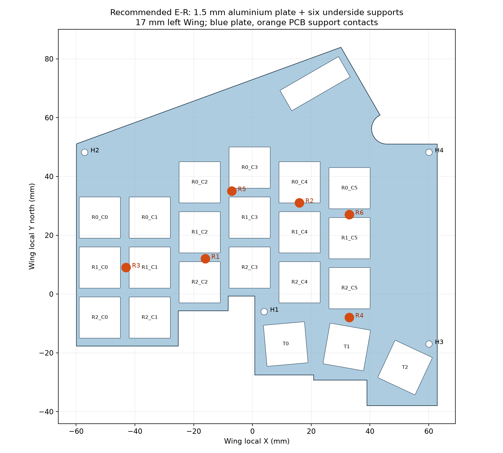
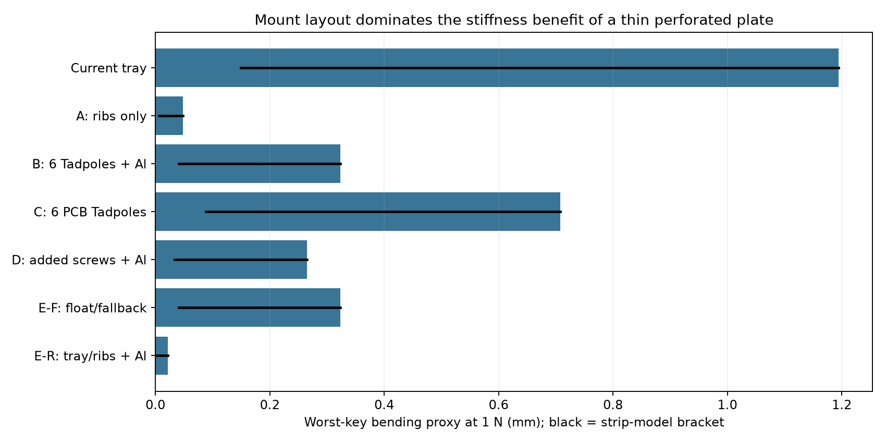

# Issue #230 — Wing mount and switch-plate design study

2026-11-13 · branch `issue-230-mount-study` · study only · dimensions in mm.

## Decision

**Recommend E-R: retain the four tray fixing sites, add six removable insulating underside supports per Wing, and fit a 1.50 mm aluminium switch plate. No Wing Rev.4 is needed. Do not adopt a floating mount for this implementation.** This is the best evidenced overall combination under the PO ordering of cost, low backtracking, freedom and speed: distributed support removes the long PCB cantilevers; the plate positively retains the magnetic switch housings; the hardware is reversible. It gives a firm, substantially more uniform typing surface. It does not establish that firm typing is everyone's favourite feel.

The PO's leading candidate, plate-tab Tadpoles, was evaluated with both the original four sites and a better six-site layout. Six plate supports still leave a 47.01 mm worst nearest-support distance because the lower-left key field cannot accommodate conventional sockets above the crowded plate without extending over the flush palm shelf. Their predicted rigid-body sink is permissible for Hall sensing, but it does not cure the remaining bending. Four-point floating mounts have a 56 mm span. PCB-mounted Tadpoles preserve the flexible PCB as the load-bearing member. Neither is a low-risk improvement here.

The recommendation is conditional on ordinary part acceptance: plate thickness/clip fit, support height and assembled keycap clearance must meet the explicitly defined gauges below. These are measurements, not unspecified design choices. No tactile preference, acoustics, dynamic force curve or sensing accuracy has been measured. The quantitative comparison is a transparent screening model, not a validated FEA or a claim of micron-level prediction.



## Verified starting point and scope

Case sources are `../issue-228-final/base.py`, `details.py`, `verify.py`, each pitch's `dimensions.json`, and `inputs/rev3-final/{keys,holes,outline}-*.csv`. Electrical geometry is read from the final Issue #200 Rev.3 `main.kicad_pcb` and `definition.json` for all four variants. [Input hashes](inputs-sha256.json) pin the exact data used. The inherited tree's README still describes its separate Fly/USB source-model blockers; this study neither resolves nor conceals those blockers.

Each Wing has 21 keys, 1.2 mm PCB at Z10.0–11.2, four Ø2.2 mounting holes and no switch plate. Four Ø4.5 bosses extend from the floor top Z2 to PCB bottom Z10; Ø1.7 pilots, M2×6 thread-forming screws and 0.5 insulating washers. No other Wing ribs, ledges or foam are generated. Nominal cavity height is 8 mm. `verify.py` reports a **reserved** 4.6 mm minimum under-component-to-floor clearance (not a measurement of an ordered PCBA). Switch locators and sensor positions are unchanged. At 17 mm the measured nearest-boss distances are min 11.42, median 31.36, max 55.98; exactly five of 21 exceed 40 mm. Both sides reproduce this result.

Jade Pro is a magnetic switch with plastic locator legs and no electrical switch contacts. The Wing's sensors and other electronics are soldered; the **switch itself is neither soldered nor electrically socketed**. Thus the proposed plate clips retain the switch, the existing Ø1.7 PCB locator holes locate it, and four rigid spacers tie the PCB and plate together. Never rely on nonexistent solder pins to make a moving stack.

## Load model, section properties and limits

Primary comparison: one quasi-static downward **1 N** load at each key centre separately, about twice the datasheet's nominal 50 gf bottom force; report all 21 keys. Also check 2 N hard presses and a 5 N total chord. Linear bending/sink values scale with load until contact, nonlinear silicone response or geometric constraints intervene. Impact peaks are not predicted. Assume 1 N total Wing-stack dead weight for floating calculations; actually weigh the assembly before setting its resting height.

Distance is Euclidean key centre to nearest support centre; these are geometric statistics, not load-path lengths. Conservative edge cantilever strip approximation: `δ = F d³/(3 EI)`. A favourable fixed-fixed strip of span `2d`, loaded centrally, gives `δ = F d³/(24 EI)`. The bracket expresses boundary-condition sensitivity, **not rigorous upper/lower bounds on the irregular two-dimensional board**. It ignores PCB orthotropy, torsion, multi-support interaction and inertia. A narrow local ligament may bend more; plate action may bend less. Distances to an unconstrained point alone cannot certify stiffness. The unchanged support layout is particularly poor for corner loading.

PCB strip: width = pitch, thickness 1.2, E = 20 GPa; at 17 mm `I = 2.448 mm⁴`, `EI = 48,960 N mm²`. Plate: thickness 1.5, effective load-bearing web width `pitch−14` = 3 mm at 17 pitch and 2 mm at 16 pitch; at 17 pitch `I = 0.84375 mm⁴`. This deliberately discounts the cutouts rather than treating the plate as a solid 17 mm-wide beam. Nominal moduli are engineering assumptions to be varied, not lot certificates. Copper stiffness is omitted.

| Plate | Assumed E (GPa) | Perforated plate EI (N mm²) | Independent stack EI (N mm²) | B six-point worst bend (mm) |
|---|---:|---:|---:|---:|
| FR4 1.5 mm | 20 | 16875 | 65835 | 0.526 |
| aluminium 1.5 mm | 69 | 58219 | 107179 | 0.323 |
| POM 1.5 mm | 2.8 | 2362 | 51322 | 0.675 |
| PC 1.5 mm | 2.3 | 1941 | 50901 | 0.680 |

The stack EI above is `EIpcb + EIplate`, assuming equal curvature with longitudinal slip. **Do not apply a parallel-axis sandwich multiplier:** four discrete ties, locator legs and bearing contact cannot guarantee continuous shear transfer. Plate centre Z15.45, PCB centre Z10.6: the 4.85 mm separation would make a fully bonded aluminium composite approximately 4.25 million N mm², about 40 times the slip value; this benefit is explicitly excluded. For the recommendation use the **PCB-only** rib-supported result as the loss-of-coupling sensitivity. At 17 mm, even this is 0.048 mm versus 1.194 mm for the current tray proxy. The plate-assisted estimate is 0.022 mm, a 54× reduction; the coupling-independent comparison is 25×. These ratios are within this model only.

The tabulated values describe bending relative to the supports; they are **not equal to Hall sensor–magnet error**. A seated housing follows nearby board displacement. Local curvature and loss of seating change the sensing gap. For a separate conservative local check, use housing half-width `a=7.9 mm`, curvature envelope `κ=F d/EI`, and chord-to-centre sag `κ a²/2`. At 1 N this gives reference PCB 0.036 mm, six-point B aluminium 0.014 mm, and E-R 0.0056 mm with equal-curvature coupling, or 0.012 mm with PCB alone. These are geometry proxies, not measured magnetic errors: actual contacts, locator friction and plate clips determine differential motion. Do not translate the 25×/54× support-deflection ratios into Hall accuracy ratios. Rigid translation/tilt of an adequately tied stack does not by itself change its sensing gap.

## Numerical comparison

All rows below use 17 mm left; the right mirrors it. Detailed min/median/max/std/spread live in [summary.json](summary.json); every option/key pair lives in each variant's `per-key.csv`. Spread is largest minus smallest estimated deflection across the 21 singly loaded keys. Rigid-body float is reported separately.

| Option | Distance min / median / max (mm) | Worst bend bracket (mm) | Deflection spread, upper proxy (mm) |
|---|---:|---:|---:|
| Reference: current four screws | 11.424 / 31.364 / 55.980 | 0.149–1.194 | 1.184 |
| A: four screws + six ribs, no plate | 7.000 / 10.039 / 19.209 | 0.006–0.048 | 0.046 |
| B: six Tadpoles + Al plate | 13.000 / 25.495 / 47.012 | 0.040–0.323 | 0.316 |
| B: six Tadpoles + FR4 plate | 13.000 / 25.495 / 47.012 | 0.066–0.526 | 0.515 |
| B: six Tadpoles + POM plate | 13.000 / 25.495 / 47.012 | 0.084–0.675 | 0.661 |
| B: six Tadpoles + PC plate | 13.000 / 25.495 / 47.012 | 0.085–0.680 | 0.666 |
| C: PCB Tadpoles, four existing sites | 11.424 / 31.364 / 55.980 | 0.149–1.194 | 1.184 |
| C: six new PCB Tadpoles (Rev.4) | 13.000 / 25.495 / 47.012 | 0.088–0.707 | 0.692 |
| D: eight screws, no plate | 10.000 / 22.413 / 44.000 | 0.072–0.580 | 0.573 |
| D: eight screws + Al plate | 10.000 / 22.413 / 44.000 | 0.033–0.265 | 0.262 |
| E-F: six Tadpoles + screw fallback + Al | 13.000 / 25.495 / 47.012 | 0.040–0.323 | 0.316 |
| E-R: four screws + six ribs + Al | 7.000 / 10.039 / 19.209 | 0.003–0.022 | 0.021 |



A uses the same six support contacts as E-R. D uses four additional sites screened against switch bodies, existing lands, vias and signal tracks; local power-plane relief is explicitly required in `rev4-legal-boss-candidates.csv`. The tempting six interior screw sites that would reproduce A's distances fail either housing/head clearance or copper collision checks (`rev4-boss-screen.json`). Their ideal 0.048 mm plateless result is retained in the data as **unbuildable at those sites**, not used to rank D. No signal was rerouted. Hole clearances must be rechecked on actual KiCad geometry before any Rev.4 is fabricated.

B's six points are a best-effort greedy minimax search on a 1 mm grid within the existing PCB/pocket, with an Ø8 socket envelope clear of the 17 mm cap reservations and tall top components. Their coordinates are in `floating-six-point-candidates.csv`; they are XY screening candidates, not a released case bracket. They improve distance but cluster north of the weak keys and increase rocking leverage. This is not a proof that every possible bespoke ear, tiny socket or alternative tab is impossible. Such a scheme would require more case/PCB development and would rank worse for backtracking and speed. Enlarging the PCB's southern outline would conflict with the required existing pocket; extending plate tabs onto the shelf conflicts with its flush treatment.

## Floating travel and retention: B, C and E-F

The official [GEON product](https://geon.works/products/tadpole) lists silicone D3.0 pins at 50A–90A. The GEON-labelled section drawing reproduced by the [retailer](https://shop.green-keys.info/products/tadpole) shows an Ø3 +0.05 top bore, Ø4.8 head, 1.5 plate, 5 mm stem engagement reference, 3.1 mm space below plate and a 0.2 head-to-bottom-case allowance. A dimensional drawing is **not** a force/displacement curve. No published pin load curve was found.

For a calculable sensitivity study, assume equivalent vertical tangent stiffness per pin 3.0 / 6.75 / 11.5 N/mm at 50A / 70A / 80A, each uncertain by ×0.5…×2. These roughly correspond to unconfined elastomer moduli 2.45 / 5.5 / 9.35 MPa with effective compression area 3.8 mm² and length 3.1 mm. Real constraint, rib friction, preload and loading history can dominate. Shore hardness alone does not specify stiffness.

Rigid plate spring model includes translation and tilt: rows of `A` are `[1,x_i,y_i]`; displacement under key load at `h=[1,x,y]` is `F hᵀ(Aᵀ k A)⁻¹h`. Reactions are `F A(AᵀA)⁻¹h`. Model assumes bilateral retention; negative reactions require uplift restraint. Four original sites include ten keys outside their convex hull. Minimum reaction is −0.598 N per 1 N press; the screened six-point layout reaches −0.742 N/N. An unsecured, compression-only support would rock and violate this calculation.

| Layout | Hardness | Key-induced sink min–max, 1 N (mm) | Worst sink with stiffness uncertainty (mm) | 1 N distributed dead load settle (mm) |
|---|---|---:|---:|---:|
| existing4 | 50A | 0.084–0.438 | 0.877 | 0.083 |
| existing4 | 70A | 0.037–0.195 | 0.390 | 0.037 |
| existing4 | 80A | 0.022–0.114 | 0.229 | 0.022 |
| screened6 | 50A | 0.056–0.794 | 1.588 | 0.056 |
| screened6 | 70A | 0.025–0.353 | 0.706 | 0.025 |
| screened6 | 80A | 0.015–0.207 | 0.414 | 0.014 |
| pcb_rev4six | 50A | 0.056–0.794 | 1.588 | 0.056 |
| pcb_rev4six | 70A | 0.025–0.353 | 0.706 | 0.025 |
| pcb_rev4six | 80A | 0.015–0.207 | 0.414 | 0.014 |

C at the original holes uses existing4; a mounting-only Rev.4 alternative uses pcb_rev4six, adds its own PCB bending and explicitly requires local plane clearance where listed in `pcb-floating-rev4-candidates.csv`; B six-point and E-F use screened6. Adding all 21 equal point loads is not a typing chord model; use actual simultaneous key locations. As a conservative 5 N chord bound, multiply maximum single-key compliance by five. For screened6 this is 3.97 / 1.76 / 1.04 mm nominal at 50A / 70A / 80A before hard stops; uncertain values can double. Two-newton single presses double table values. Distributed dead-weight settlement shown is `W/(n k)` under equal pin loading; eccentric real centre of mass adds tilt.

A credible floating design would therefore use **70A for an experiment**, Ø3.05 plate tab bores, socket-to-tab alignment ±0.10, relieved/deletable original bosses, a **1.0 mm downward hard stop**, and **0.25 mm uplift stop** with mechanical tabs captured under removable case retainers. Allow Ø5.2 head pocket, Ø8 structural socket outside diameter and 1.0 minimum retainer wall. The stem requires a 5 mm bore above plate top: Z16.2 to21.2. Blind bore roof ≥1 mm implies Z22.2 total local height. These supports cannot simply be hidden in the existing Z15.2 rim. H3's original XY would overlap a Ø6 socket with the conservative keycap envelope by 0.803 mm; moving the socket is mandatory. No recommendation to drill or print that collision is made.

Bottom budget: nominal 4.6 mm minus 0.3 placement/tolerance allowance minus 1.0 stopped sink leaves **3.3 mm** to the floor, before local bending. Floating PCB bosses must terminate ≤Z8.7 to leave 1.0 motion plus 0.3 allowance; unmodified Z10 bosses block all downward float. C's pin body also needs a local PCB-height/socket design, not an unsupported substitution into Ø2.2 holes. D3.0 bores need verified local copper relief. B's floating stack must have independent plate–PCB ties at the original holes; C lacks the stiffening plate.

Top budget is **not proven by the inherited CAD**: its keycaps are solid 17×17 reservations from Z11.2 to25.2, not actual skirt profiles. Thus no physical cap-to-ledge travel can honestly be extracted from them. Required floating acceptance envelope: actual fully depressed cap skirt at least **1.3 mm above any fixed ledge** at nominal rest (1.0 sink +0.3 margin); nearest high-wall XY gap at least 0.25 mm **after** tilt/side drift. Lateral clearance is already only 0.25 mm in the case reference, so soft uncontrolled lateral movement is not free. Sinking the entire stack does not alter the cap-to-plate relationship, but sinking into fixed walls can cause rubbing. These unresolved floating gates are additional backtracking, not sensing objections to rigid-body travel.

Retention must not depend on silicone friction. Design uplift retainers for **20 N per Wing**, applied at any key, and a 5g carrying inversion test; 1 N stack weight makes 5g only 5 N. Four retainers each rated at least 20 N locally accommodate uneven load sharing. Keycap pulling can remove a clipped switch before it lifts the full assembly: use a switch puller while supporting the plate. The datasheet's 1.5 kgf internal adhesive-force value is not a specified case-mount or plate clip pull-out rating. E-F must keep fallback screws out while floating; installed/tightened screws short-circuit its compliance. A dual arrangement that leaves screws clamped is a tray mount, not a floating mount.

## Plate material, manufacturing and cost

The [Jade Pro datasheet](https://www.gateron.com/u_file/2505/21/file/GateronMagneticJadeProSwitchKS-20TF10B045NW-Y106PRO1.pdf), pages 4 and 7 (also already stored at `hardware/kicad/qualification/issue-194-wing-rev2/sources/jade-pro.pdf`), specifies the 14 mm aperture (+0.05/−0.02), plate thickness 1.50 (+0.01/−0.05), C0.2 and 10.16 mm locator spacing. Thus generic '14 mm MX, 1.5 mm' is appropriate only with these tighter fit requirements. Its side drawing gives the 5 mm PCB-top to plate-seating relationship. Keep the PCB 1.2 mm sensing stack.

FR4 is cheapest in quantity, electrically insulating and relatively stiff. But [JLCPCB capabilities](https://jlcpcb.com/capabilities/Capab.../) lists standard 1.6 mm stock, ±10% thickness above 1 mm and regular ±0.2 / precision ±0.1 mm routing: those do **not guarantee** the switch drawing's thickness or aperture tolerances. Do not quietly order 1.6 and call it 1.5. A custom controlled 1.5 laminate/machining quote or a measured fit coupon would be needed. Plates are ~123×122 mm, outside the common ≤100×100 promotion. Separate handed plates may count as two designs, per [JLC's panel policy](https://jlcpcb.com/help/article/different-design-in-your-pcb-files). Budget separately; no live project quote was obtained.

Aluminium 5052-H32, 1.50 mm, deburred and thickness inspected, is the selected material. It provides ~3.45 times FR4's plate-web EI, and holds switch clips without polymer creep. Use a plate-cutting vendor with actual 1.5 stock and fit inspection, not a nominal 0.063 inch /1.60 mm substitute. Ordinary laser cutting alone may not hold ±0.02 mm apertures; finish machine/ream the clip-bearing flats or have the specialist guarantee the fit. The [LaserBoost keyboard service](https://www.laserboost.com/keyboards/) advertises plates from €27 each and no minimum; this is a channel reference, **not a quote for these four geometries**.

Unfilled POM and polycarbonate can soften sound and local feel but their thin perforated webs add only ~5% or ~4% to PCB EI here; they do not replace close PCB support. CNC route 1.5 sheet, support it during machining, deburr; do not assume laser-cut PC has clean, dimensionally stable edges. Both require thickness sorting and creep/clip retention checks. Nominal modulus assumptions are consistent with the grade ranges discussed by [MCAM for POM](https://www.mcam.com/mcam/products/pom) and [Protolabs for PC](https://www.protolabs.com/services/cnc-machining/plastics/polycarbonate/), but neither is a certificate for a procured sheet.

Incremental budgets below are **JPY per two-Wing keyboard**, excluding freight/tax except where explicitly stated, existing PCBA and the normal base case. They are planning ranges, not purchases/quotations. Same aluminium plate cost applies across mount types; evaluating A plateless against B plated is not a fair cost comparison by itself.

| Option | Incremental parts / manufacture budget | Assembly, tuning, fallback |
|---|---|---|
| A, ribs / plateless | ¥50–200 printed supports and shims | 12 removable posts; retains locator-only switch retention; remove posts to revert |
| B, six pins/Wing + FR4 | ¥1,500–4,500 plate pair amortized + ¥700 pins + ¥100–400 retainers; custom thickness may exceed range | Plate clips + 8 stack ties + 12 pins, height fitting, uplift retainers; hardness swappable |
| B, six pins/Wing + aluminium | ¥4,000–9,000 plate pair + ¥700 pins + ¥100–400 retainers + ¥200–600 ties | More development in sockets/capture; 70A experiment; screws available only if separately preserved |
| C, PCB Tadpoles / plateless | ¥700 pins + ¥100–400 retainers; Rev.4 setup allowance ¥1,000–5,000 beyond normal board order | PCB bore/retention development; unchanged long-span bending; spare hardness pack additional |
| D, eight screws/Wing / plateless | ¥100–300 screws + ¥50–200 bosses; Rev.4 setup allowance ¥1,000–5,000 | Eight new holes/plane clearances per keyboard, extra screw assembly and electrical requalification |
| D + aluminium plate | D + ¥4,000–9,000 plate pair + ¥200–600 spacers | Stiffer, still 44 mm worst span; reversal cannot restore drilled PCB material |
| E-F floating + screw fallback | B-aluminium + ¥100–300 bypass hardware | Most tunable, most parts; clamped and floating modes mutually exclusive |
| **E-R recommended** | **¥4,000–9,000 plate pair + ¥200–600 spacers/long screws + ¥50–200 posts/shims** | **No PCB revision; four fasteners/Wing; pull posts or remove plate to revert** |

PO reference pin cost is ¥700/14, so 12 pins consume ¥600, one pack purchased at ¥700 leaves two spares. Live [Yushakobo page](https://shop.yushakobo.jp/en/products/12313) showed ¥770 tax included on retrieval, with hardness-specific availability; other cached listings show ¥990. Use ¥770–990 purchasing allowance if that is the actual checkout price. Availability and PO-supplied stock statements are not a force-curve qualification. FR4's cheaper price is a real advantage, outweighed here by fit risk and likely rework; low backtracking follows cost in the priorities.

## Ranked recommendation and why

1. **E-R: four-site tray + removable underside support + aluminium plate.** Lowest development cost among plated solutions with convincing support uniformity. No board order delay, no routing change, positive switch retention. Conservative PCB-only result is still much better than all screened floating layouts. Tadpole hardness: **not applicable; zero pins in this BOM**.
2. **A: same tray supports, plateless.** Lowest cash expense and easiest intermediate build, but omits the requested plate's switch retention and bending benefit. It is the immediate fallback if plate fit fails, not the final requested stack.
3. **B: six-point plate Tadpoles, aluminium, 70A experimental.** Best floating candidate; potentially preferable if soft whole-stack motion becomes the top priority. Needs real cap geometry, force tests and a new capture/socket solution; no claimed objective tactile superiority.
4. **E-F: B with retained screw fallback.** Same floating mechanics as B; buys reversibility at higher part count and clearance complexity. Useful in an experimental case, not the lowest-cost current build.
5. **D: added bosses, preferably plated.** Mounting-only Rev.4 is permitted, but conventional screws cannot occupy the best underside-only locations. North-side additions reduce the longest span to44 mm, with electrical/assembly work and little advantage over removable ribs.
6. **C: direct PCB Tadpoles.** Adds compliance without reinforcing the PCB; the four-site version retains reference bending, and the six-site mounting-only Rev.4 remains a long-span cantilever (see table). Least aligned with sensing uniformity.

This ranking is robust to losing all assumed plate coupling, and to choosing softer/stiffer pins: hard support geometry is what wins the deflection comparison. It is **not** robust to replacing the objective with 'maximum cushioned motion regardless of cost'; B would then merit prototyping. There is no quantitative proof of subjective 'best feel' from these sources alone.

## Released study geometry for E-R

Each `17mm-left`, `17mm-right`, `16mm-left`, `16mm-right` directory supplies authoritative `plate.geojson`, `plate.dxf`, 1:1 `plate.svg`, `plate-study.stl`, `cutouts.csv`, `tie-holes.csv`, `supports.csv`, `per-key.csv`, checks and candidate screens. DXF units are mm, XY local X right/Y north. SVG displays north up. STL uses assembly **Z** heights but local XY; it is a study solid, not a plate vendor order file. Cut all exterior/interior DXF loops; CNC/laser kerf compensation belongs outside the specified finished dimensions. Circular DXF loops are chordal approximations ≤0.001 mm radial error. The drawing order never changes key/sensor/connector locations.

| Feature | Fixed definition |
|---|---|
| Plate material / finish | 5052-H32 aluminium, bare deburred; no ferromagnetic material; electrically isolated from PCB by POM spacers |
| Plate thickness | 1.50 mm nominal, accept 1.45–1.51 after finish; flatness ≤0.10 across Wing |
| Plate Z | bottom14.70, top16.20; original PCB bottom10.00, top11.20 |
| Plate outline | Original Wing outline offset inward0.20, miter joins; GH mated-body keepout enlarged0.50 subtracted; no projecting palm tabs |
| Switch apertures | 21 per CSV, nominal14.02 square, finished14.00–14.04, R0.20 internal corners; C0.20 underside lead-in, preserve top clip-bearing edge |
| Stack ties | Four old H coordinates, Ø2.20 plate through holes; four POM tubular spacers Ø3.80 OD /Ø2.20 ID ×3.50 height (±0.03) per Wing |
| Fixing screws | Four M2×12 polymer-compatible thread-forming, max head Ø3.8, 0.5 insulating washer max Ø4.0, per Wing; same Ø1.7 pilots; 5.3 engagement from washer/plate/spacer/PCB stack |
| Boss seats | Retain Z10 and Ø4.5; pilot depth8 from Z10 to2. Screw tip nominal Z4.70, 2.70 above floor top; do not bottom in pilot |
| Distributed supports | Six per Wing at supports.csv; Ø3 shaft Z2.5–10; Ø4.5 collar Z2–2.5; Ø3.15 peg Z1.2–2; nonconductive PETG; contact disk flat and smooth |
| Removable post sockets | Floor bores finished Ø3.10 ±0.05, depth0.80 from Z2, leaving1.20 floor; light interference fit to measured peg; no outer-surface opening |
| Support fit | Trim post top or add captured PET shim to leave0…0.02 gap below PCB; never jack the PCB above boss plane; check unclamped and after tightening |
| Stop/retention | Normal tray screws give positive uplift restraint; no floating travel, no silicone socket, no additional above-plate bracket |

Generic support STL pieces are separate shaft/collar/peg volumes sharing interface faces; union them for a print part. No production case/PCB file was edited. A follow-on case change adds only the six local floor sockets per Wing; existing outer silhouette, flush shelf, bosses, rack and connector seating remain at their current coordinates. Counterbore fitting must not breach the floor. The small support diameter is intentional to avoid underside components, solder lands, locator legs and vias. Full plane copper below solder mask is permissible beneath these **insulating** contacts; no copper is removed.

For 17 mm left, supports R1–R6 are respectively **(−16,12), (16,31), (−43,9), (33,−8), (−7,35), (33,27)**. Their worst contact-edge separation from the conservative land/drill/body union is0.626 mm; all four variants' minima are in `checks.json`. The right-side files mirror geometry where valid; do not manually mirror a support across electrical obstacles. Four tie holes are **(4,−6), (−57.1,48.2), (60.1,−17), (60.1,48.2)** on17 mm left. Assembly XY for every support/tie is included in CSV, with exact source transforms in checks. Plate area is6394.20 mm² on17 mm left, ~25.9 g at aluminium density2.7 g/cm³.

## Clearance and assembly acceptance

No XY plate material extends beyond the original PCB; nominal plate-to-pocket gap is0.70 mm, compared with PCB-to-pocket0.50. Existing high walls are outside the cavity. No new material is placed on the palm shelf above Z11.2. Support shafts are wholly inside the Wing projection, in verified component/locator-free areas; their low collars cannot reach components whose reserved lowest Z is6.6. Floor sockets end atZ1.2. Electrical parts, switch locators and connectors are unchanged.

For E-R, reserve **0.10 mm** total loaded downward PCB movement (0.048 model worst without plate help +0.02 seating gap +0.03 allowance). This leaves at least **4.50 mm** of the original4.6 floor reservation at1 N. At2 N, conservative0.097+0.02+0.03=0.147 movement leaves4.45 mm. This is comfortably inside the cavity. The support contact model does not predict rebound damping or an impact overload rating.

Rack lowest solid isZ20.2, storage isZ22.2–24.2, plate top16.2: vertical separations4.0 and6.0 respectively. Wing harness tube endpoint centreZ18.2, radius1, gives **1.0 mm** nominal underside-to-plate separation; the GH access notch retains0.5 XY around its mated body. Cruise centreZ23.2 clears plate by6.0 at tube underside. These are conservative elevation/XY-envelope checks from the source, not a rerun of the complete source STEP collision suite. No change to harness routes or slack storage is proposed. Keep the notch available for plug/unplug and inspect the actual exit wire bend.

The plate changes no switch seating height: housing feet stay on PCB top11.2 and plate top16.2 captures the flange. Actual fully depressed keycap skirts must clear plate top by **≥0.30 mm** and fixed case ledges by **≥0.40 mm** at the nominal unloaded build; allow0.10 load movement, leaving0.30 to case. Cap-to-high-wall XY clearance must remain≥0.25. Inherited cap blocks cannot verify this physical skirt gauge; record the gauge for the purchased cap profile. If caps fail, use the plateless fallback and report the incompatible profile; do not raise the plate, change key positions or silently alter the approved case.

Assembly sequence: clean/dry the support contacts; fit six posts and trim/shim flush to the four boss-seat plane; loosely place PCB; insert four POM spacers and plate; seat all21 switches fully and verify both clips; fit washers and M2×12 screws, tighten evenly just to seating without warping the board. Check switch-to-PCB housing contact at the far keys and no PCBA rocking. Plate spacers secure the assembly even when switches are removed. Insulate/reject burrs, especially near the GH cutout and top-side parts. Verify the3.5 mm interlayer gap against actual top-side component heights (excluding GH in its notch); the conservative mux body footprint is screened, but component height is not a new certified supplier maximum.

Acceptance: apply1 N at all21 keys; compare unloaded/loaded PCB-to-switch housing spacing, with **≤0.10 mm** differential deflection target and **≤0.07 mm** key-to-key spread. Measure with a dial gauge referenced to the case and a second gauge on the adjacent PCB to distinguish whole-stack motion from bending. Confirm full return and stable Hall readings; rigid-body displacement alone is not a sensing failure. Carry inverted at5g equivalent and pull a cap with the assembly secured, verifying no plate lift or loose posts. Record results; if model and hardware disagree, accept the measurement. No assertion of passing these physical tests is made in this study.

Fallback: remove plate/spacers, reinstall the original M2×6 and0.5 washers, retaining the six support posts for A. If a support causes preload, remove that post while correcting its height; do not bend the board into it. Pull all six posts to restore the original four-site mount; empty blind sockets do not interfere. Aluminium plate and Rev.3 PCBs remain reusable for a later floating-case experiment. Converting E-R to floating is not achieved by loosening screws: original bosses and support posts would prevent movement.

## 16 mm mapping

Use the16 mm source key/hole/outline CSVs, not a uniform16/17 scale: stagger offsets, thumb angles, fixed switch envelopes and connectors do not scale. The generator repeats obstacle checks independently for each handed PCB. Apertures remain14.02 and plate thickness1.50; webs decrease from nominal3 to2 mm. Sensor locations, locator holes and harness endpoints follow their unchanged variant data.

| Variant | E-R distance median / max (mm) | E-R worst bend bracket (mm) | E-R upper-proxy spread (mm) | Conservative PCB-only worst (mm) |
|---|---:|---:|---:|---:|
| 17mm-left | 10.039 / 19.209 | 0.003–0.022 | 0.021 | 0.048 |
| 17mm-right | 10.039 / 19.209 | 0.003–0.022 | 0.021 | 0.048 |
| 16mm-left | 11.464 / 17.839 | 0.003–0.022 | 0.021 | 0.041 |
| 16mm-right | 11.860 / 17.839 | 0.003–0.022 | 0.020 | 0.041 |

All21-key results for every combination and both pitches are committed. The geometry-only contact checks do not substitute for board-fabrication tolerances or physical sensing/feel tests.

## Reproduction and evidence

From checkout root, with all caches/scratch under `.issue230-runtime/`:

```bash
mkdir -p .issue230-runtime/tmp .issue230-runtime/cache .issue230-runtime/mplconfig
export TMPDIR="$PWD/.issue230-runtime/tmp"
export XDG_CACHE_HOME="$PWD/.issue230-runtime/cache"
export MPLCONFIGDIR="$PWD/.issue230-runtime/mplconfig"
export PYTHONDONTWRITEBYTECODE=1
# Python dependencies: numpy, shapely>=2.1, sexpdata, matplotlib.
.issue230-runtime/venv/bin/python hardware/case/issue-230-mount-study/study.py
.issue230-runtime/venv/bin/python hardware/case/issue-230-mount-study/build_review.py
.issue230-runtime/venv/bin/python hardware/case/issue-230-mount-study/verify_study.py
```

`study.py` reads only production sources, writes only its own study directory and emits hashes, support and collision screens, exact 2D drawing data, all per-key mechanical estimates and floating tables. `build_review.py` emits study STLs and the two review figures. `verify_study.py` checks regeneration invariants, hashes, aperture positions, clearances, fastener dimensions and CSV completeness. Results are in `verification.json`. No production STEP/STL, case generator, routed Wing board, or other electrical design was modified; no push or PR is part of this work.


## Supplement — acrylic (PMMA) plate candidate, 2026-11-13

This supplements the original study at `2f62ad3` for the PO's explicitly requested acrylic candidate. The original report, recommendation geometry and existing numerical results above remain unchanged. **Acrylic does not change the ranked recommendation: E-R with aluminium remains first.** PMMA is a conditional transparent/coloured appearance or potentially lower cutting-cost variant of E-R, not a stiffness upgrade or a qualified replacement for aluminium. No acrylic sample, supplier quote or retention-life test was obtained.

### Same mechanical framework

Use **E = 3.3 GPa (3300 N/mm²)** for ordinary unfilled PMMA, cast or extruded. [PLEXIGLAS GS/XT technical information 211-1, August 2024, page 4](https://www.plexiglas.de/files/plexiglas-content/pdf/technische-informationen/211-1-DE-PLEXIGLAS-GS-XT.pdf) gives this short-term tensile modulus under ISO 527-2/1B/1, at 23 °C / 50% RH, for standard GS and XT. It is a nominal screening input, not a flexural/creep modulus certified for a purchased 1.5 mm sheet; impact-modified grades require a different input.

Keep `t = 1.50`, effective web `pitch−14`, the 1.2 mm PCB, all support coordinates, 1 N single-key load, independent-slip sum `EIstack = EIpcb + EIplate`, and the original `d³/(24 EI)…d³/(3 EI)` bracket. No sandwich multiplier or new shear-transfer assumption is introduced.

| PMMA plate, pitch | Web width (mm) | Plate I (mm⁴) | E (GPa) | Perforated plate EI (N mm²) | Independent stack EI (N mm²) |
|---|---:|---:|---:|---:|---:|
| 1.50 mm, 17 mm | 3 | 0.84375 | 3.3 | 2784.375 | 51744.375 |
| 1.50 mm, 16 mm | 2 | 0.56250 | 3.3 | 1856.250 | 47936.250 |

At 17 mm PMMA adds only 5.69% to PCB EI; it is slightly stiffer than the POM and PC assumptions, far below FR4 and aluminium. The following rows use exactly the main comparison's definitions and can be compared directly with its material/layout rows. At 2 N double the bending values; the same model caveats apply. Floating spring sink is separate and unchanged at the same assumed load and pin stiffness; a lighter plate is not a substitute for measuring actual stack weight.

| Option, 17 mm left | Distance min / median / max (mm) | Worst bend bracket (mm) | Deflection spread, upper proxy (mm) |
|---|---:|---:|---:|
| B: original four Tadpoles + PMMA | 11.424 / 31.364 / 55.980 | 0.141–1.130 | 1.120 |
| B: six Tadpoles + PMMA | 13.000 / 25.495 / 47.012 | 0.084–0.669 | 0.655 |
| D: eight screws + PMMA | 10.000 / 22.413 / 44.000 | 0.069–0.549 | 0.542 |
| E-F: six Tadpoles + screw fallback + PMMA | 13.000 / 25.495 / 47.012 | 0.084–0.669 | 0.655 |
| E-R: four screws + six ribs + PMMA | 7.000 / 10.039 / 19.209 | 0.006–0.046 | 0.043 |

| Variant | B six-point PMMA worst bend (mm) | E-R PMMA worst bend (mm) | E-R PMMA upper-proxy spread (mm) |
|---|---:|---:|---:|
| 17mm-left | 0.084–0.669 | 0.006–0.046 | 0.043 |
| 17mm-right | 0.084–0.669 | 0.006–0.046 | 0.043 |
| 16mm-left | 0.080–0.638 | 0.005–0.039 | 0.037 |
| 16mm-right | 0.080–0.638 | 0.005–0.039 | 0.036 |

As with aluminium, E-R must also tolerate loss of plate coupling: the original PCB-only worst values remain 0.048 mm at 17 mm and 0.041 mm at 16 mm. Acrylic does not justify fewer underside supports. The figures are short-term elastic estimates; they do not predict clip damage or sustained-load creep.

### Stock, laser process and switch fit

**Nominal 1.5 mm acrylic is available; guaranteed 1.45–1.51 mm finished plate is a different procurement requirement.** The [PLEXIGLAS GS/XT range](https://www.plexiglas.de/de/produkte/plexiglas/plexiglas-gs-xt) lists clear extruded sheet at 1.5 mm; its standard cast sheet starts at 2 mm in technical information 211-1. Thin cast stock therefore needs a separately identified supplier/grade; do not substitute 2 mm or assume every colour is stocked at 1.5 mm. A [Japanese acrylic fabricator's published material list](https://www.rinz.co.jp/price1.html) also includes 1.5 mm clear/white stock, without certifying this switch tolerance.

The [manufacturer's thickness guidance](https://www.plexiglas.de/en/contact) gives extruded XT **±10% below 3 mm**: nominal 1.5 means 1.35–1.65 mm. Its cast GS formula is **±(0.4 + 0.1t) mm**, much wider still; applying it at 1.5 would mean ±0.55 mm, but this is not evidence that standard 1.5 mm GS is offered. As another real thin-stock example, [ACRYLITE's extruded tolerance table](https://www.acrylite.co/resources/knowledge-base/article/what-is-the-thickness-tolerance-of-acrylite-r-extruded-ff-acrylic-sheet?category=product-properties) labels 0.060 inch as 1.5 mm but permits 0.054–0.066 inch, or **1.3716–1.6764 mm**. Even the nominal 0.060 inch is 1.524 mm, above Jade Pro's 1.51 maximum. Extrusion's better consistency is useful for sorting but does not guarantee fit. Generic cast or extruded stock cannot honestly be specified as meeting the switch drawing without inspection or a special tolerance agreement.

CO₂ laser cutting is the ordinary practical channel for this thin, intricate PMMA plate. Here there are **42 switch apertures per pair**, nominal 14.02 mm with finished 14.00–14.04 flats, R0.20 corners, narrow 3 mm / 2 mm pitch webs, four tie holes per Wing and a connector notch. Kerf compensation, taper, corner dwell and local melting must be qualified with the actual sheet and machine. [ACRYLITE's laser-machining guidance](https://www.acrylite.co/resources/fabrication-manuals/laser-machining-acrylite) warns that glossy cuts can carry greater edge stress, and inside corners can overheat and craze under mechanical load or incompatible solvents. A visually polished aperture therefore does not certify a sound clip-bearing edge. At R0.20, use controlled corner energy and reject microcracks, chips and melted/rounded clip seats. A normal perpendicular laser cut also does not create the specified underside C0.20 lead-in; qualify a secondary operation while preserving the top retaining edge. Enlarging corner radii or apertures to avoid cracking would require renewed switch-fit qualification, not an unnoticed drawing change.

This is a brittle, notch-sensitive plate with little material between switches. The switch's resilient plastic clips flex during insertion, but the PMMA edge must carry their bearing and pull-out loads. Repeated insertion, levering or extracting a switch with clips still engaged may chip that edge or start cracks at aperture corners. The risk is worse in the 16 mm webs and at stressed tie holes. This is an engineering assessment from this geometry and the manufacturer's machining cautions, not a measured cycle-life ranking. Cast stock may be worth testing for processing behaviour, but its thickness variation does not disappear; extruded stock's uniformity does not establish durable retention.

Long-term clip bearing, screw preload and plate warp also need checks. [ACRYLITE cast physical properties](https://www.acrylite.co/files/content/acrylite.co/documents/product-information/ACRYLITE-cast-Physical-Properties.pdf) describes cold flow under sustained loading and stress crazing below short-term tensile strength. The 3.3 GPa calculation consequently cannot certify lifetime retention. Do not overtighten the existing ties, force a warped sheet flat, use solvent cement/threadlocker near apertures, or clean stressed edges with an unapproved chemical. Keep the existing independent spacers and insulating supports; they must carry assembly loads without demanding switch clips provide stack shear transfer. Supplier-approved stress relief may help, but remeasure dimensions and flatness after any thermal treatment.

**Fit verdict: conditional feasibility only, with sorting and finished-part inspection.** Map sheet thickness before nesting and verify 1.45–1.51 mm at every aperture's clip-bearing regions after cutting/finishing, using a calibrated micrometer with suitable access and measurement uncertainty. Inspect all 42 apertures on both faces for finished dimensions, taper, R0.20/C0.20 and cracks under magnification; retain the existing ≤0.10 mm Wing flatness requirement. A representative coupon must reproduce the narrowest web, corners and clip edges, then demonstrate full Jade Pro seating, both clips engaged and no housing lift from the PCB. For a prototype, record retention before and after at least 20 supported insertion/removal cycles and a one-week assembled dwell at the intended maximum service temperature, then repeat fit and retention checks. Those are proposed screening gates, not demonstrated tests or a service-life qualification. Reject loosening, crazing or chips; measure longer-term retention before making a durability claim. Frequent switch swapping is a poor intended use for this variant.

### Additional budget row (JPY per two-Wing keyboard)

| Option | Incremental parts / manufacture budget | Assembly, tuning, fallback |
|---|---|---|
| E-R with 1.50 mm PMMA, CO₂ laser-cut handed pair | **¥2,500–6,500 plate pair** ordinary cutting allowance; **add ¥1,000–3,000** for thickness sorting, fit inspection and finishing; same ¥200–600 spacers/long screws + ¥50–200 posts/shims | Same supports/ties as E-R; coupon and retention checks required; replace cracked plates; frequent switch removal discouraged |

Basis: two roughly 123×122 mm blanks (about 0.030 m² before nesting), 42 aperture loops plus outlines/tie holes, approximately 3.5 m total finished-loop cutting path (17 mm pair: 3496.8 mm, from `plate.geojson`; excludes machine lead-ins). The range allocates ¥500–1,500 material/offcut use, ¥1,500–3,500 setup/cutting, and ¥500–1,500 coupon/rework allowance. These are analyst planning allocations, not vendor rates. The fabricator list above gives a **¥2,200 / 550×400 / 1.5 mm clear sheet** reference; its page is an undated legacy price list, not a verified current quote. Shared sheet/offcut costing supports the allocation, but a whole-sheet minimum, special thin cast stock, colour, low sorting yield or precision finishing can exceed it. The additional inspection allowance is also an estimate, not a guaranteed service. Excludes freight/tax, laboratory life testing and PCBA/base case, consistently with the main budget. Any B/E-F PMMA experiment uses the same plate-pair allowance plus its original pins, ties and capture hardware. No purchase is proposed. There is no assured cost advantage over an accepted aluminium pair once fit assurance and replacements are included.

### Recommendation and reproduction impact

Keep the six-way mount ranking and aluminium E-R recommendation unchanged. Acrylic sits alongside POM/PC as an optional polymer variant, with slightly greater nominal EI in this model and useful transparency/colour, but added brittle-edge and retention risks. Accept it only for a supported E-R prototype whose actual stock passes thickness/flatness and aperture inspection, whose switch coupon passes seating and removal checks, and whose owner accepts restricted switch swapping and replacement on damage. It is not an approved drop-in vendor order or a reason to adopt the B floating layout. A bare nominal-thickness laser-cut acrylic pair without those checks fails the evidence needed to claim Jade Pro fit.

`study.py` now adds PMMA through the same material dictionary and emits the original-four and six-point B rows plus D, E-F and E-R PMMA rows for every pitch/hand. `summary.json` and all four `per-key.csv` files include them; existing options retain their original values and ordering relative to one another. Original aluminium geometry and review figures are unchanged. Run the existing reproduction commands above; `verify_study.py` also checks PMMA's independent EI and matching support distances. Physical acrylic acceptance remains unperformed.

Supplement validation: regenerated `study.py` data and passed `verify_study.py` (all four variants; hashes, geometry, meshes, arithmetic and PMMA layout/EI checks). Compared against `2f62ad3`: all 76 original summary rows and 1,596 original per-key rows are exactly preserved; 20 PMMA summary rows and 420 PMMA per-key rows are added. The original report is an unchanged prefix; no geometry, floating tables, source hashes or review figures changed. `git diff --check` passed. Scratch validation output is under `.issue230-runtime/`.
